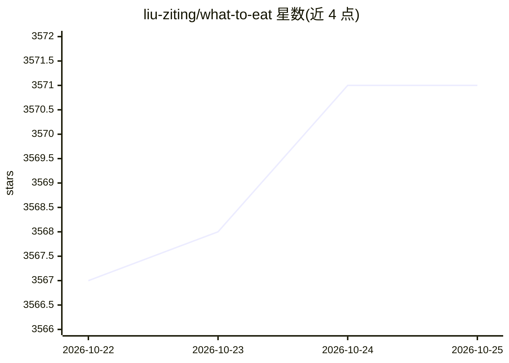

# liu-ziting/what-to-eat

⭐ 3,571 · Vue · 推送 2026-01-12 · [GitHub](https://github.com/liu-ziting/what-to-eat) · [官网](http://eat.lz-t.top) · 个人维护 · 中文 README

**给烹饪用户的 AI 菜谱生成 Web 平台，覆盖八大菜系与国际料理**

基于 Vue 3 + TypeScript + Vite 的前端 Web 应用：按食材和菜系偏好调用 OpenAI 标准兼容 API 生成菜谱，附带营养分析与健康评分、AI 菜品图片生成、酒水搭配推荐、酱汁配方设计、收藏管理与料理占卜等功能。内置动态配置系统，用户可在运行时修改文本生成与图片生成的 API 地址、密钥、模型、温度等参数，支持任何 OpenAI 兼容的服务商，并提供连接测试与一键恢复默认。通过 git clone 源码本地开发，或一键部署到 Vercel/Netlify，环境要求 Node.js 18+。

## 筛选速览

| 维度 | 判定 | 备注 |
|---|---|---|
| AI 角色 | `ai-native` | 本体是模型或模型工具 |
| 许可风险 | `none` | — |
| 部署形态 | `None` |  |
| 模型依赖 | — | README 未给出锁定关系 |
| 硬件要求 | — | 无带数字的原话,不猜 |
| 安装摩擦 | `low` | 无编译、无系统依赖或容器化 |
| 成熟度 | — | 结构信号不足 |

## 能力要点

- 基于食材与菜系偏好的菜谱生成，附营养分析与健康评分
- AI 菜品效果图生成与酒水搭配推荐
- 运行时动态配置系统：模型参数实时生效、独立配置文本/图片模型、连接测试
- 兼容任何 OpenAI 标准 API 服务，支持多服务商切换

## 适用场景

- 根据现有食材和口味偏好生成菜谱和制作步骤
- 生成菜谱时获得营养成分分析与酒水搭配建议
- 自由切换不同 AI 模型接口体验不同风格的菜谱

## 场景标签

`AI 助手` `图像生成` · 领域:对话与助手

## 证据(README 行号)

> L7: 基于 AI 的智能菜谱生成平台，支持中华八大菜系 + 国际料理，提供营养分析、酒水推荐、菜谱效果图生成等功能。
> L17: - **智能菜谱生成** - 基于食材和菜系偏好生成专业菜谱

## 星数曲线

2026-10-22 3,567 → 2026-10-25 3,571（+4）

---
*卡片 v1 · prompt 1.4 · 生成 2026-10-21 · 置信度 high · 依据 README sha `4553648e8bee` · [字段定义](../../DATASET.md)*
