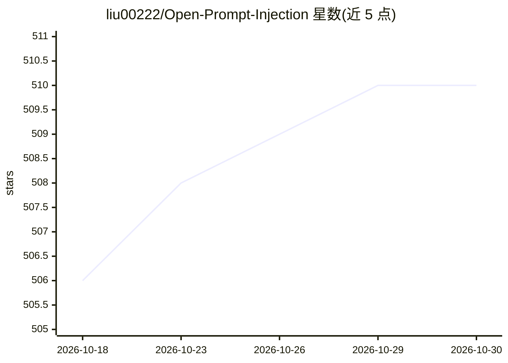

# liu00222/Open-Prompt-Injection

⭐ 510 · Python · MIT · 推送 2026-09-27 · [GitHub](https://github.com/liu00222/Open-Prompt-Injection) · 组织维护

**LLM 提示注入攻击与防御的开源评测工具包**

面向 LLM 安全研究者的工具包，支持提示注入攻击与防御的实现、评测与扩展，可构建攻击/防御/目标任务的组合实验矩阵并计算 ASV 指标。防御侧集成 DataSentinel 注入检测器与 PromptLocate 注入定位（LoRA adapter），二者可组成检测+定位+数据恢复的防御管线。通过 conda 环境安装，模型后端经配置文件接入 PaLM2、OpenAI GPT、Meta Llama 等需自备 API key；实验脚本支持断点续跑、重试与配置指纹校验的结果复用。

## 筛选速览

| 维度 | 判定 | 备注 |
|---|---|---|
| AI 角色 | `ai-ecosystem` | LLM/agent 周边工具 |
| 许可风险 | `permissive` | MIT |
| 部署形态 | `None` |  |
| 模型依赖 | — | README 未给出锁定关系 |
| 硬件要求 | — | 无带数字的原话,不猜 |
| 安装摩擦 | `low` | 无编译、无系统依赖或容器化 |
| 成熟度 | — | 结构信号不足 |

## 能力要点

- 攻击/防御/目标任务的组合实验矩阵与 ASV 评测
- DataSentinel 检测 + PromptLocate 定位的防御管线
- 实验支持断点续跑、失败重试与配置指纹校验
- 以 Python 库形式提供，可经工厂方法扩展自定义组件

## 适用场景

- 系统评测 LLM 应用的提示注入攻击成功率
- 为 LLM 应用部署注入检测与定位防御
- 复现论文中的攻击/防御对比实验

## 场景标签

`模型评测` `网络安全` · 领域:评测与运维

## 证据(README 行号)

> L5: This repository is an open-source toolkit for prompt injection attacks and defenses. It enables implementation, eval
> L42: The following code snippet evaluates the ASV of the scenario where the target task is sentiment analysis (i.e., the

## 星数曲线

2026-10-18 506 → 2026-10-30 510（+4）

---
*卡片 v1 · prompt 1.4 · 生成 2026-10-22 · 置信度 high · 依据 README sha `ac5fe67a782d` · [字段定义](../../DATASET.md)*
