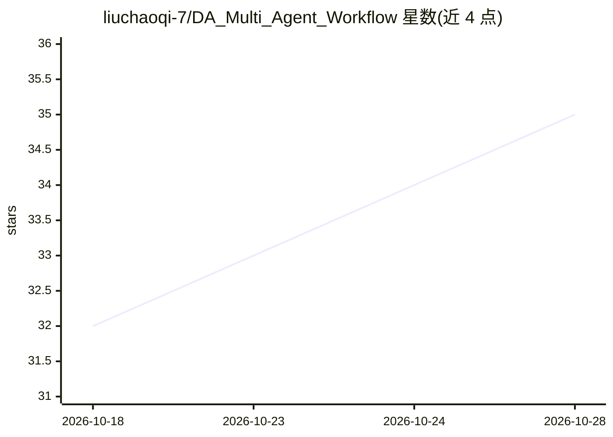

# liuchaoqi-7/DA_Multi_Agent_Workflow

⭐ 35 · JavaScript · MIT · 推送 2026-04-03 · [GitHub](https://github.com/liuchaoqi-7/DA_Multi_Agent_Workflow) · 个人维护 · 中文 README

**电商多平台数据中台：n8n+LLM 实现 ETL、数仓建模与飞书智能问数**

面向电商业务的全域数据中台方案，覆盖抖店、小红书、微信视频号、巨量千川、电商罗盘五平台。架构为 Python CLI 脚本（ETL 采集、SQL 建模、飞书同步）+ n8n 工作流调度；数仓按 ODS/DWD/DIM/ADS 分层。AI 部分包括 Supervisor 路由的多智能体协作（Text-to-SQL、报告增强、QA 质检、QuickChart 图表），素材智能诊断（Whisper ASR + 千问大模型 + 极值截图 + Excel 报告），企业级增强版含权限控制、RAG 知识库与审计日志。用户在飞书端以自然语言提问获得分析结果。含 API 与爬虫（DrissionPage）双模式采集。

## 筛选速览

| 维度 | 判定 | 备注 |
|---|---|---|
| AI 角色 | `ai-native` | 本体是模型或模型工具 |
| 许可风险 | `permissive` | MIT |
| 部署形态 | `self-host` | docker 或自建部署 |
| 模型依赖 | — | README 未给出锁定关系 |
| 硬件要求 | — | 无带数字的原话,不猜 |
| 安装摩擦 | `low` | 无编译、无系统依赖或容器化 |
| 成熟度 | — | 结构信号不足 |

## 能力要点

- 五平台多源数据自动采集（API + 爬虫双模式）
- Supervisor Agent 路由的多智能体 Text-to-SQL 问答与自动可视化
- 素材智能诊断：Whisper ASR + 千问大模型 + Excel 诊断报告
- ODS/DWD/DIM/ADS 数仓分层与元数据数据字典自动治理

## 适用场景

- 统一采集和管理多个电商平台的订单、售后、结算与投放数据
- 在飞书里用自然语言查询数据库并自动生成图表报告
- 批量诊断投放素材视频，提取文案卖点与高潮画面
- 搭建带权限控制和 RAG 知识库的企业级数据分析机器人

## 场景标签

`数据分析` `多智能体` `网页抓取` `RAG` · 领域:Agent 开发

## 证据(README 行号)

> L36: - **🎬 素材智能诊断（Whisper ASR + 千问大模型 + 极值截图 + 诊断报告）**
> L37: - **🤖 多智能体协作架构（Supervisor Agent 路由分发 + 专业 Agent 协作 + Text-to-SQL + 自动可视化）**
> L154: 本项目实现了一套 **多智能体协作架构**（Multi-Agent Architecture），基于 **n8n + LangChain + 千问大模型**，通过 **Supervisor Agent 路由分发** 实现任务智能

## 星数曲线

2026-10-18 32 → 2026-10-28 35（+3）

---
*卡片 v1 · prompt 1.4 · 生成 2026-10-25 · 置信度 mid · 依据 README sha `d2151b20e988` · [字段定义](../../DATASET.md)*
