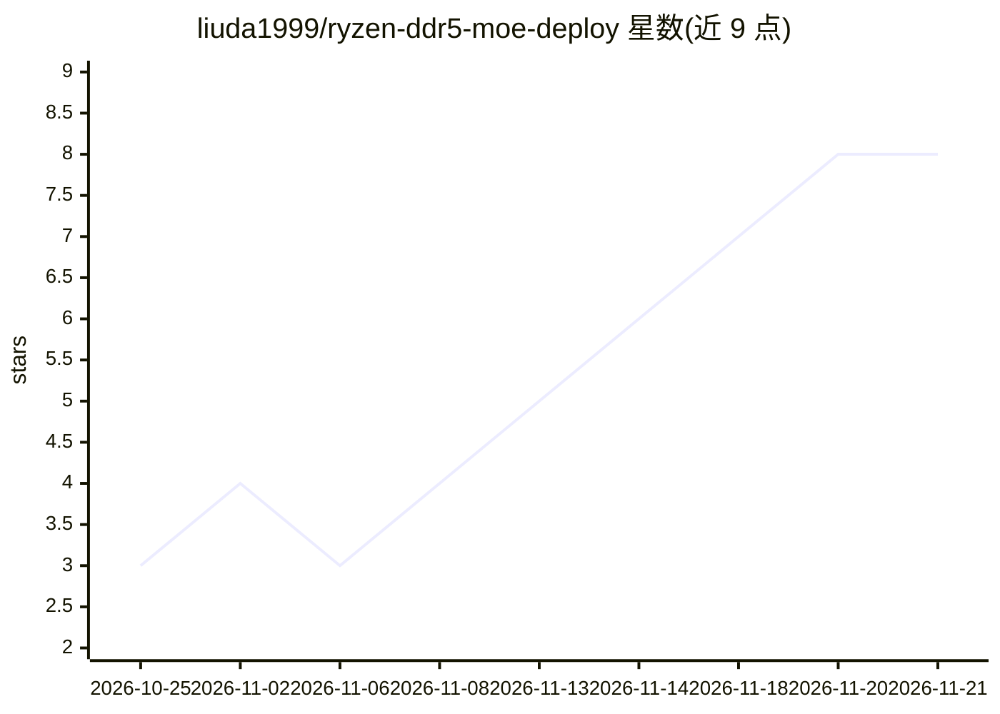

# liuda1999/ryzen-ddr5-moe-deploy

⭐ 8 · C++ · NOASSERTION · 推送 2026-11-10 · [GitHub](https://github.com/liuda1999/ryzen-ddr5-moe-deploy) · 个人维护 · 中文 README

**让消费级显卡在 Windows 本机跑动 30B~35B MoE 大模型**

把 llama.cpp 封装为 Windows 上双击即用的本地 MoE 推理套件：显存承担每 token 必读的非专家权重，占大头的专家权重留内存由 CPU 计算；无独显时纯 CPU 兜底。脚本固化模型下载（curl 断点续传）、显存预算与卸载层数自动计算、9 个指令集变体运行时择优、启停、密钥鉴权、局域网开放与 /health 就绪判定。仅支持 Windows 10/11 x64，源码公开但非商业使用需作者书面授权，非 OSI 认可许可。

## 筛选速览

| 维度 | 判定 | 备注 |
|---|---|---|
| AI 角色 | `ai-ecosystem` | LLM/agent 周边工具 |
| 许可风险 | `none` | NOASSERTION |
| 部署形态 | `None` |  |
| 模型依赖 | local-ok | 支持本地模型 |
| 硬件要求 | `gpu-8g` | |
| 安装摩擦 | `medium` | 含编译或系统依赖之一 |
| 成熟度 | — | 结构信号不足 |

## 能力要点

- 显存+内存混合卸载（--n-cpu-moe），3 GB 显存即可跑 30B~35B MoE 模型
- 免装运行库：VC++ 运行时随包附带，不装 VS/CUDA/Python
- 内置 10 项环境与安全检查、/health 真就绪判定、启动后预热请求
- OpenAI 兼容 API（端口 35035），换 .gguf 模型改一行即可

## 适用场景

- 在没有专业卡的家用电脑上搭建本地 AI 服务，数据不出本机
- 用游戏显卡（3~16 GB 显存）混合卸载跑 MoE 大模型
- 给局域网内其他设备提供带密钥鉴权的 OpenAI 兼容接口

## 场景标签

`推理引擎` · 领域:训练与推理

## 证据(README 行号)

> L37: 把 llama.cpp 封装成**双击即用**的本地 MoE 推理套件：模型下载、显存预算、指令集变体、
> L10: > 剩余显存继续把**专家层**也搬上显存，占大头的专家权重留内存由 CPU 算；没有独显时纯 CPU 兜底。
> L243: OpenAI 兼容，端口固定 **35035**（刻意避开 8080 / 8000 / 11434）。

## 星数曲线

2026-10-25 3 → 2026-11-21 8（+5）

---
*卡片 v1 · prompt 1.4 · 生成 2026-11-20 · 置信度 high · 依据 README sha `f6442d1e0ec5` · [字段定义](../../DATASET.md)*
