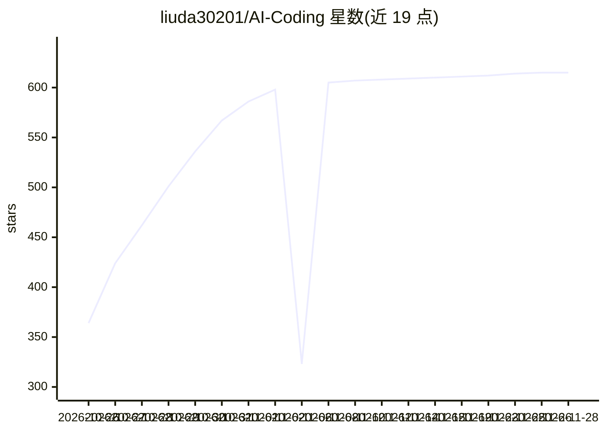

# liuda30201/AI-Coding

⭐ 615 · HTML · 推送 2026-11-27 · [GitHub](https://github.com/liuda30201/AI-Coding) · [官网](https://liuda30201.github.io/AI-Coding/) · 个人维护 · 中文 README

**AI 编程中转站与公益站福利导航清单**

汇总面向 Claude Code、Codex、Cursor 客户端的 API 中转站与公益站，整理各站注册福利、邀请码、签到活动、接口协议与评测记录，并提供使用注意事项（不提交敏感代码、核对到账等）。维护机制上，GitHub Actions 工作流每 3 小时探测站点在线状态并更新 JSON 数据、HTML 看板与公告摘要，通过 GitHub Pages 部署；Python 脚本可从本地 JSON 重新生成页面并同步。README 明确评分为编辑推荐口径，赠额信息可能过期。

## 筛选速览

| 维度 | 判定 | 备注 |
|---|---|---|
| AI 角色 | `ai-knowledge` | 知识聚合/清单类 |
| 许可风险 | `none` | — |
| 部署形态 | `None` |  |
| 模型依赖 | — | README 未给出锁定关系 |
| 硬件要求 | — | 无带数字的原话,不猜 |
| 安装摩擦 | `low` | 无编译、无系统依赖或容器化 |
| 成熟度 | — | 结构信号不足 |

## 能力要点

- 10 个中转站的推荐榜单，含注册福利与邀请码
- GitHub Actions 每 3 小时自动探测站点并更新看板
- 各站接口协议记录（OpenAI Chat/Anthropic Messages/Codex Responses）
- HTML 可视化看板 + JSON 持久化数据 + 页面生成脚本

## 适用场景

- 寻找支持 Claude Code 或 Cursor 的中转站和公益站
- 比较各站注册赠额与签到福利
- 查看中转站在线状态与最新公告

## 场景标签

`精选清单` · 领域:学习与行业

## 证据(README 行号)

> L1: # 🎁 AI Coding 福利站导航
> L3: 免费额度 · Claude Code / Codex / Cursor 中转站与公益站合集
> L169: - ⚙️ 自动更新：`.github/workflows/refresh-relay-dashboard.yml` 每 3 小时探测一次，更新 JSON、看板和公告摘要，并部署 Pages；首次启用请在仓库 **Settings

## 星数曲线

2026-10-26 364 → 2026-11-28 615（+251）

---
*卡片 v1 · prompt 1.4 · 生成 2026-11-28 · 置信度 high · 依据 README sha `20d1491033fe` · [字段定义](../../DATASET.md)*
