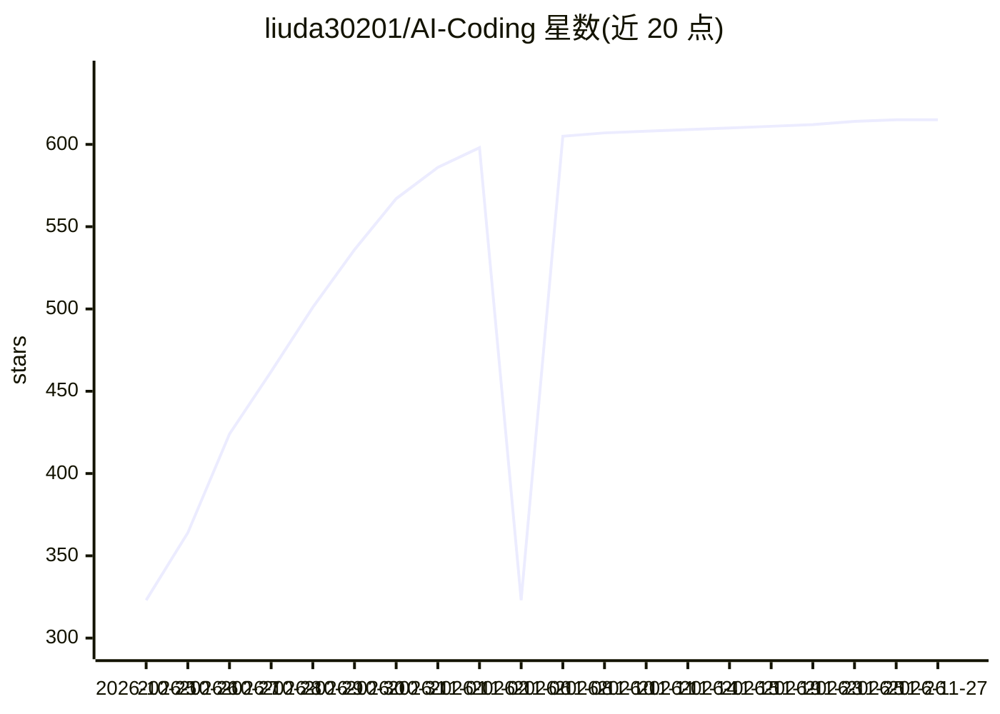

# liuda30201/AI-Coding

⭐ 615 · HTML · 推送 2026-11-26 · [GitHub](https://github.com/liuda30201/AI-Coding) · [官网](https://liuda30201.github.io/AI-Coding/) · 个人维护 · 中文 README

**AI 编程中转站福利导航：汇总 Claude Code/Codex/Cursor 站点赠额信息**

面向使用 Claude Code、Codex、Cursor 等编程工具的用户，收录 10 个中转站与公益站的注册福利、邀请码、签到活动与评测记录，并注明赠额为公开资料口径、可能过期。维护机制包括 GitHub Actions 每 3 小时探测站点在线状态与公告、更新 JSON 数据与 HTML 看板并部署 GitHub Pages；提供 Python 脚本从本地 JSON 重新生成页面及同步脚本。README 明确评分为编辑推荐指数，非模型性能实测，且不代收费用、不承诺可用性。

## 筛选速览

| 维度 | 判定 | 备注 |
|---|---|---|
| AI 角色 | `ai-knowledge` | 知识聚合/清单类 |
| 许可风险 | `none` | — |
| 部署形态 | `None` |  |
| 模型依赖 | — | README 未给出锁定关系 |
| 硬件要求 | — | 无带数字的原话,不猜 |
| 安装摩擦 | `low` | 无编译、无系统依赖或容器化 |
| 成熟度 | — | 结构信号不足 |

## 能力要点

- 10 个中转站的注册福利、邀请码与签到活动汇总
- GitHub Actions 每 3 小时自动探测站点状态与公告并更新看板
- 注明评分为编辑推荐指数，非模型性能实测
- Python 脚本支持从本地 JSON 重新生成页面

## 适用场景

- 查找 Claude Code/Codex/Cursor 中转站的免费额度信息
- 核对各站点注册方式、签到规则与注意事项
- 了解中转站在线状态与公告更新情况

## 场景标签

 · 领域:AI 工具资源导航/信息聚合

## 证据(README 行号)

> L1: # 🎁 AI Coding 福利站导航
> L5: > 📌 推荐顺序与页面一致；评分为编辑推荐指数，不是模型性能实测。
> L169: - ⚙️ 自动更新：`.github/workflows/refresh-relay-dashboard.yml` 每 3 小时探测一次，更新 JSON、看板和公告摘要，并部署 Pages；首次启用请在仓库 **Settings

## 星数曲线

2026-10-25 323 → 2026-11-27 615（+292）

---
*卡片 v1 · prompt 1.4 · 生成 2026-11-27 · 置信度 high · 依据 README sha `0fd44d2ff809` · [字段定义](../../DATASET.md)*
