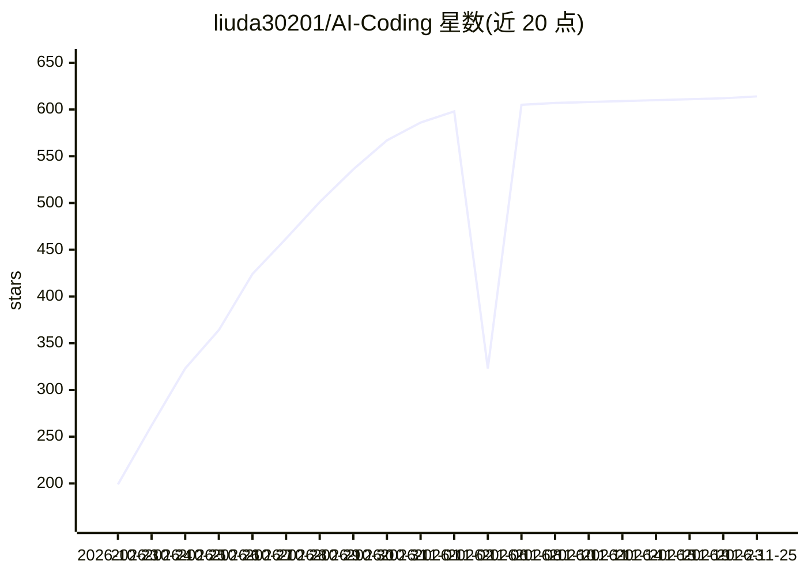

# liuda30201/AI-Coding

⭐ 614 · HTML · 推送 2026-11-23 · [GitHub](https://github.com/liuda30201/AI-Coding) · [官网](https://liuda30201.github.io/AI-Coding/) · 个人维护 · 中文 README

**为 AI 编程用户汇总中转站与公益站的福利导航看板**

以 Markdown 清单与 HTML 看板形式汇总面向 Claude Code、Codex、Cursor 等 AI 编程工具的中转站与公益站，整理各站注册福利、签到活动、邀请码、接口协议与评测记录，并附风险提示。GitHub Actions 每 3 小时自动探测站点状态并更新 JSON 数据与公告摘要，提供 Python 脚本从本地 JSON 重新生成页面及 GitHub 同步脚本。声明评分属编辑推荐指数而非模型性能实测，赠额信息可能过期。

## 筛选速览

| 维度 | 判定 | 备注 |
|---|---|---|
| AI 角色 | `ai-knowledge` | 知识聚合/清单类 |
| 许可风险 | `none` | — |
| 部署形态 | `None` |  |
| 模型依赖 | — | README 未给出锁定关系 |
| 硬件要求 | — | 无带数字的原话,不猜 |
| 安装摩擦 | `low` | 无编译、无系统依赖或容器化 |
| 成熟度 | — | 结构信号不足 |

## 能力要点

- 汇总 10 个推荐站点及邀请码、注册福利与签到活动
- GitHub Actions 每 3 小时自动探测站点在线状态并更新看板
- 持久化数据为单一 JSON 文件，提供 Python 页面生成与同步脚本

## 适用场景

- 寻找 Claude Code/Codex/Cursor 可用的中转或公益站点
- 对比各站注册赠额与签到福利后再注册
- 跟进站点公告与活动是否过期

## 场景标签

`精选清单` · 领域:学习与行业

## 证据(README 行号)

> L1: # 🎁 AI Coding 福利站导航
> L3: 免费额度 · Claude Code / Codex / Cursor 中转站与公益站合集
> L169: - ⚙️ 自动更新：`.github/workflows/refresh-relay-dashboard.yml` 每 3 小时探测一次，更新 JSON、看板和公告摘要，并部署 Pages；首次启用请在仓库 **Settings

## 星数曲线

2026-10-23 199 → 2026-11-25 614（+415）

---
*卡片 v1 · prompt 1.4 · 生成 2026-11-25 · 置信度 high · 依据 README sha `12ba632bf545` · [字段定义](../../DATASET.md)*
