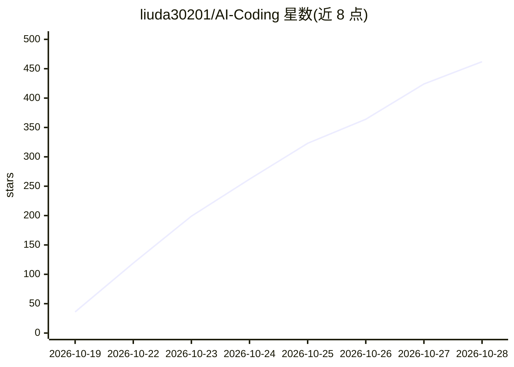

# liuda30201/AI-Coding

⭐ 501 · HTML · 推送 2026-10-28 · [GitHub](https://github.com/liuda30201/AI-Coding) · [官网](https://liuda30201.github.io/AI-Coding/) · 个人维护 · 中文 README

**AI 编程中转站/公益站福利导航与自动探测看板**

汇总 Claude Code、Codex、Cursor 相关 API 中转站与公益站的信息清单：按推荐榜单列出 10 个站点的注册福利、签到活动、邀请码与网页评测记录，并保留各站公告快照与使用注意事项。通过 GitHub Actions 每 3 小时自动探测站点在线状态，更新 JSON 数据、HTML 可视化看板与公告摘要并部署到 GitHub Pages；本地可用 python main.py 从 JSON 重新生成页面。README 明确声明赠额可能过期、站内额度不等价现金、不承诺可用性。

## 筛选速览

| 维度 | 判定 | 备注 |
|---|---|---|
| AI 角色 | `ai-knowledge` | 知识聚合/清单类 |
| 许可风险 | `none` | — |
| 部署形态 | `None` |  |
| 模型依赖 | — | README 未给出锁定关系 |
| 硬件要求 | — | 无带数字的原话,不猜 |
| 安装摩擦 | `low` | 无编译、无系统依赖或容器化 |
| 成熟度 | — | 结构信号不足 |

## 能力要点

- 10 个中转站推荐榜单：注册福利、签到活动、邀请码与评测记录
- GitHub Actions 每 3 小时自动探测 24 个站点并更新公告快照
- HTML 可视化看板部署于 GitHub Pages，数据持久化为 JSON
- 提供使用建议与风险提示（不保证到账、不代收费用）

## 适用场景

- 查找有免费额度的 Claude Code / Codex / Cursor 中转站
- 比较各站注册福利、签到活动与倍率信息
- 跟踪中转站公告与在线状态变化

## 场景标签

`精选清单` · 领域:学习与行业

## 证据(README 行号)

> L3: 免费额度 · Claude Code / Codex / Cursor 中转站与公益站合集
> L164: - 🌐 在线首页（HTML 看板）：GitHub Pages
> L169: - ⚙️ 自动更新：`.github/workflows/refresh-relay-dashboard.yml` 每 3 小时探测一次，更新 JSON、看板和公告摘要，并部署 Pages；首次启用请在仓库 **Settings

## 星数曲线

2026-10-19 36 → 2026-10-28 462（+426）

---
*卡片 v1 · prompt 1.4 · 生成 2026-10-22 · 置信度 high · 依据 README sha `773fc1c69e4c` · [字段定义](../../DATASET.md)*
