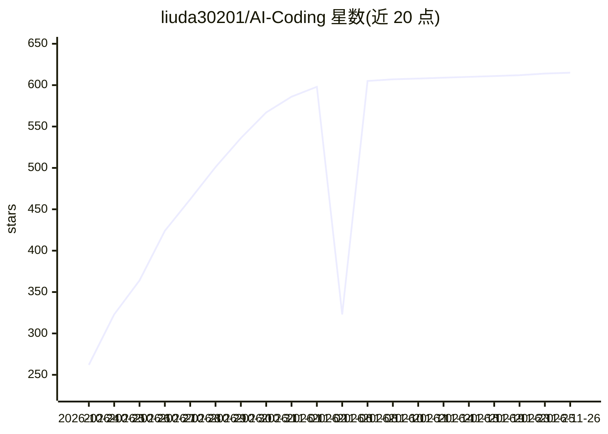

# liuda30201/AI-Coding

⭐ 615 · HTML · 推送 2026-11-25 · [GitHub](https://github.com/liuda30201/AI-Coding) · [官网](https://liuda30201.github.io/AI-Coding/) · 个人维护 · 中文 README

**给 AI 编程用户汇总 Claude Code/Codex/Cursor 中转站福利的导航**

以 Markdown 榜单、HTML 看板与 JSON 数据三形式呈现的 AI 编程中转站导航：收录 10 个站点，整理注册福利、签到活动、邀请码、接口协议兼容与网页评测记录；由 GitHub Actions 每 3 小时探测站点在线状态与公告并自动更新页面。附 Python 脚本从本地 JSON 重新生成页面、运行单元测试及同步。文中多处声明福利为公开资料口径、可能过期，不承诺到账与可用性。

## 筛选速览

| 维度 | 判定 | 备注 |
|---|---|---|
| AI 角色 | `ai-knowledge` | 知识聚合/清单类 |
| 许可风险 | `none` | — |
| 部署形态 | `None` |  |
| 模型依赖 | — | README 未给出锁定关系 |
| 硬件要求 | — | 无带数字的原话,不猜 |
| 安装摩擦 | `low` | 无编译、无系统依赖或容器化 |
| 成熟度 | — | 结构信号不足 |

## 能力要点

- 10 个中转站点的福利、邀请码与评测记录整理
- GitHub Actions 每 3 小时自动探测站点并更新看板与公告
- HTML 可视化看板与 JSON 持久化数据配套
- 提供 Python 页面生成、测试与 GitHub 同步脚本

## 适用场景

- 查找支持 Claude Code/Codex/Cursor 的中转站与公益站
- 对比各站注册福利与签到活动后再注册
- 了解各站点接口协议兼容与倍率资料

## 场景标签

`精选清单` · 领域:学习与行业

## 证据(README 行号)

> L1: # 🎁 AI Coding 福利站导航
> L3: 免费额度 · Claude Code / Codex / Cursor 中转站与公益站合集
> L164: - 🌐 在线首页（HTML 看板）：GitHub Pages

## 星数曲线

2026-10-24 262 → 2026-11-26 615（+353）

---
*卡片 v1 · prompt 1.4 · 生成 2026-11-26 · 置信度 high · 依据 README sha `6e297b558ff2` · [字段定义](../../DATASET.md)*
