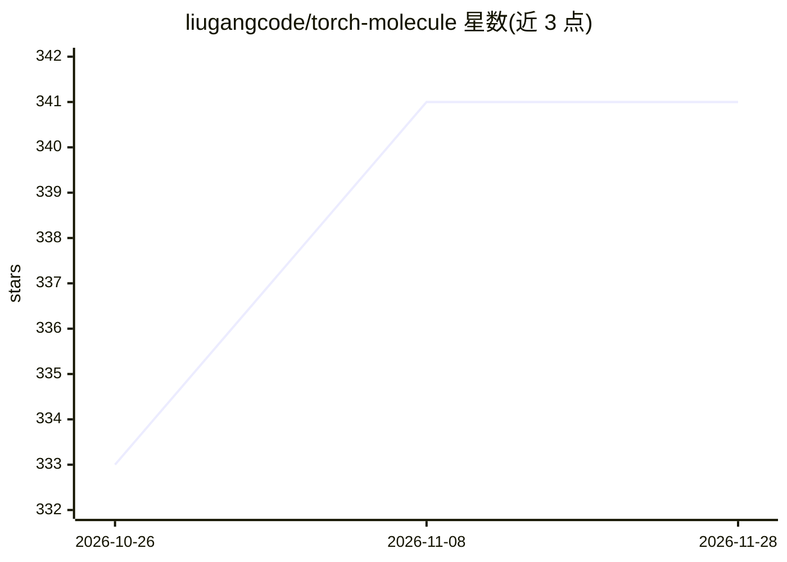

# liugangcode/torch-molecule

⭐ 341 · Python · MIT · 推送 2026-10-31 · [GitHub](https://github.com/liugangcode/torch-molecule) · 组织维护

**分子发现的 sklearn 风格深度学习库**

以 sklearn 风格接口封装分子深度学习任务，覆盖三类组件：预测模型（11 个）、生成模型（11 个）、表示模型（8 个及多个预训练权重），无需额外 SMILES 特征化即可 fit。提供 Hugging Face 上的模型 checkpoint 交互与本地保存/加载，附带分子数据集 hub 按名称加载数据并内置多种数据划分方式。要求 Python 3.10+，部分模型需 3.11+ 且 transformers 版本互相冲突需独立环境。

## 筛选速览

| 维度 | 判定 | 备注 |
|---|---|---|
| AI 角色 | `ai-native` | 本体是模型或模型工具 |
| 许可风险 | `permissive` | MIT |
| 部署形态 | `library` | 以包/库形式分发 |
| 模型依赖 | — | README 未给出锁定关系 |
| 硬件要求 | — | 无带数字的原话,不猜 |
| 安装摩擦 | `medium` | 含编译或系统依赖之一 |
| 成熟度 | — | 结构信号不足 |

## 能力要点

- sklearn 风格 fit/predict API，覆盖属性预测、逆分子设计与表示学习
- 30 余个已实现模型及论文出处（NeurIPS/ICML/ICLR 等）
- molecular dataset hub 按名称加载，含 WelQrate 十种划分方案
- checkpoint 可上传 Hugging Face 或本地 .pt 保存/加载

## 适用场景

- 对 SMILES/分子图做性质预测建模
- 生成满足特定性质条件的新分子
- 分子预训练表示学习与虚拟筛选

## 场景标签

 · 领域:计算化学/药物发现

## 证据(README 行号)

> L12: `torch-molecule` is a package that facilitates molecular discovery through deep learning, featuring a user-friendly
> L155: ## List of Supported Models

## 星数曲线

2026-10-26 333 → 2026-11-28 341（+8）

---
*卡片 v1 · prompt 1.4 · 生成 2026-11-25 · 置信度 high · 依据 README sha `e2345ace0f41` · [字段定义](../../DATASET.md)*
