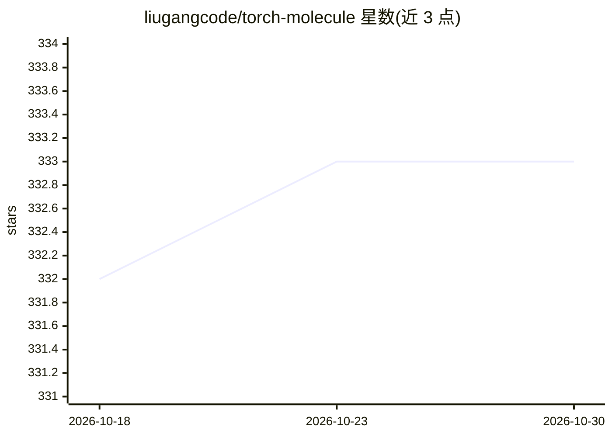

# liugangcode/torch-molecule

⭐ 333 · Python · MIT · 推送 2026-10-28 · [GitHub](https://github.com/liugangcode/torch-molecule) · 组织维护

**分子发现深度学习库：sklearn 风格接口做性质预测与生成**

基于 PyTorch 的分子深度学习 Python 包，提供 sklearn 风格 API（fit/predict），无需额外 SMILES 特征化。覆盖三类模型：预测模型（GNN、Transformer、GREA 等约 11 种）、生成模型（GenMol、DiGress、JTVAE 等约 10 种，含多个 HuggingFace 预训练模型）与表示学习模型（GraphMAE、ChemBERTa 系列等）。内置 qm9、chembl2k、toxcast 等数据集加载函数，支持 HuggingFace checkpoint 保存与加载。面向化学、生物、材料科学领域的研究者与开发者；部分模型需额外安装 transformers、torch-scatter 等可选依赖。

## 筛选速览

| 维度 | 判定 | 备注 |
|---|---|---|
| AI 角色 | `ai-native` | 本体是模型或模型工具 |
| 许可风险 | `permissive` | MIT |
| 部署形态 | `library` | 以包/库形式分发 |
| 模型依赖 | — | README 未给出锁定关系 |
| 硬件要求 | — | 无带数字的原话,不猜 |
| 安装摩擦 | `medium` | 含编译或系统依赖之一 |
| 成熟度 | — | 结构信号不足 |

## 能力要点

- sklearn 风格接口，无需额外 SMILES 特征化
- 覆盖预测、生成、表示学习三类共 30+ 种模型
- 内置 qm9/chembl2k/toxcast 等 7 个数据集加载函数
- 支持 HuggingFace checkpoint 保存、加载与部署

## 适用场景

- 用预测模型估算分子性质（量子化学、毒性、ADMET）
- 用生成模型做 de novo 分子设计与骨架补全
- 加载预训练模型做分子表示学习与虚拟筛选
- 在自有数据集上以统一接口训练与基准测试多种模型

## 场景标签

 · 领域:计算化学/药物发现

## 证据(README 行号)

> L12: `torch-molecule` is a package that facilitates molecular discovery through deep learning, featuring a user-friendly
> L84: `torch-molecule` supports applications in broad domains from chemistry, biology, to materials science. To get start

## 星数曲线

2026-10-18 332 → 2026-10-30 333（+1）

---
*卡片 v1 · prompt 1.4 · 生成 2026-10-22 · 置信度 high · 依据 README sha `2affb7c1cf1a` · [字段定义](../../DATASET.md)*
