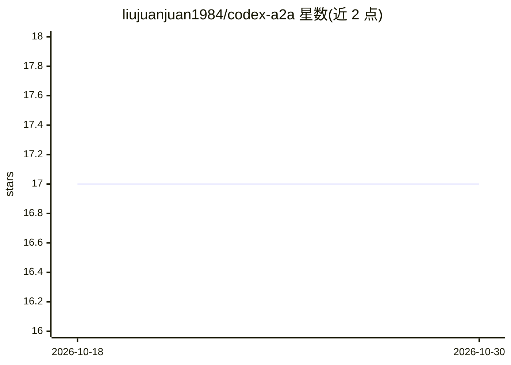

# liujuanjuan1984/codex-a2a

⭐ 17 · Python · Apache-2.0 · 推送 2026-10-29 · [GitHub](https://github.com/liujuanjuan1984/codex-a2a) · 个人维护

**为开发者把本地 Codex CLI 封装为 A2A 协议服务的适配器**

独立社区适配器，在本地 Codex CLI/App Server 之上增加 A2A 协议服务面：单进程内同时提供 A2A Server（HTTP+JSON 端点、JSON-RPC、SSE 流式、会话延续、中断处理、Agent Card 发现）与内嵌 A2A Client（a2a_call 工具与 CLI 对外调用）。面向希望保留 Codex 作为运行时并获得 A2A 传输、认证与控制边界的开发者。通过 uv tool 安装 CLI，需本地已配置好 codex CLI 与凭证；单实例为单租户信任边界，不提供多租户隔离与进程托管。

## 筛选速览

| 维度 | 判定 | 备注 |
|---|---|---|
| AI 角色 | `ai-ecosystem` | LLM/agent 周边工具 |
| 许可风险 | `permissive` | Apache-2.0 |
| 部署形态 | `None` |  |
| 模型依赖 | — | README 未给出锁定关系 |
| 硬件要求 | — | 无带数字的原话,不猜 |
| 安装摩擦 | `low` | 无编译、无系统依赖或容器化 |
| 成熟度 | — | 结构信号不足 |

## 能力要点

- 单进程内同时运行 A2A Server 与内嵌 A2A Client（a2a_call 对外调用）
- A2A 1.0 协议：HTTP+JSON /message:send、/message:stream 端点与 JSON-RPC、Agent Card 发现
- SSE 流式输出规范化 text/reasoning/tool_call 块，支持会话延续与中断生命周期映射
- 出站认证（bearer/basic）与私网目标访问控制等安全边界

## 适用场景

- 把本地 Codex 运行时暴露为 A2A 服务供外部客户端或网关调用
- 让 Codex 作为 agent 通过 a2a_call 自主调用其他 A2A 对端
- 需要带认证与流式的 A2A 传输层而不想自建协议实现

## 场景标签

`编码 Agent` · 领域:编码与开发

## 证据(README 行号)

> L22: `codex-a2a` is an independent community adapter that adds an A2A service and control boundary to the local Codex CL
> L26: - An A2A adapter service for the local Codex runtime, with inbound runtime exposure plus outbound peer calling.

## 星数曲线

2026-10-18 17 → 2026-10-30 17（+0）

---
*卡片 v1 · prompt 1.4 · 生成 2026-10-29 · 置信度 high · 依据 README sha `222436419624` · [字段定义](../../DATASET.md)*
