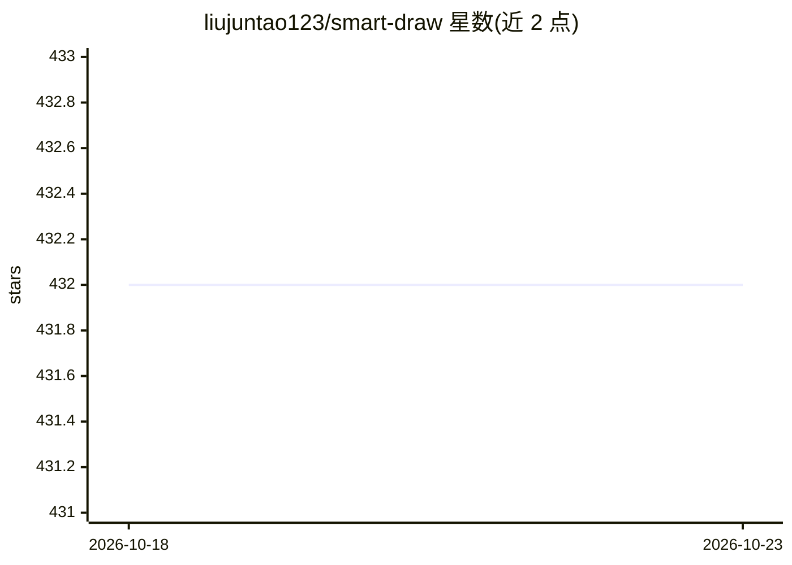

# liujuntao123/smart-draw

⭐ 432 · JavaScript · NOASSERTION · 推送 2025-12-29 · [GitHub](https://github.com/liujuntao123/smart-draw) · [官网](https://ai-draw-nexus.aizhi.site) · 个人维护 · 中文 README

**自然语言生成图表的 Web 应用，支持 Draw.io 与 Excalidraw**

基于 Next.js 的图表生成应用：用户用自然语言描述需求，LLM 生成 Draw.io 或 Excalidraw 格式图表，可在画布继续编辑。支持 20+ 种图表类型，可由 AI 自动选择类型。LLM 接入支持 OpenAI 或 Anthropic 提供商，用户可自配 API Key（存于浏览器本地），或由管理员配置服务器端统一 LLM 并以访问密码分发。提供在线站点、源码本地运行与 Docker 部署三种使用方式；许可证为 PolyForm Noncommercial，仅限非商业用途。

## 筛选速览

| 维度 | 判定 | 备注 |
|---|---|---|
| AI 角色 | `ai-native` | 本体是模型或模型工具 |
| 许可风险 | `none` | NOASSERTION |
| 部署形态 | `self-host` | docker 或自建部署 |
| 模型依赖 | locked-api |  |
| 硬件要求 | — | 无带数字的原话,不猜 |
| 安装摩擦 | `low` | 无编译、无系统依赖或容器化 |
| 成熟度 | — | 结构信号不足 |

## 能力要点

- 双绘图引擎：Draw.io（结构化）与 Excalidraw（手绘风格）
- 20+ 种图表类型，可由 AI 按描述自动选择
- 支持用户自配 API Key 或服务器端统一 LLM（访问密码模式）
- 提供 Docker / Docker Compose 部署与在线站点

## 适用场景

- 用自然语言快速画流程图、架构图、ER 图等
- 团队内部由管理员统一配置 LLM 供成员使用
- AI 生成初稿后在 Draw.io/Excalidraw 画布手动精修

## 场景标签

`代码生成` · 领域:编码与开发

## 证据(README 行号)

> L20: 通过先进的大语言模型理解你的需求，生成结构清晰、布局合理的专业级图表。
> L70: 在输入框中用自然语言描述你的需求，例如：

## 星数曲线

2026-10-18 432 → 2026-10-23 432（+0）

---
*卡片 v1 · prompt 1.4 · 生成 2026-10-21 · 置信度 high · 依据 README sha `2b1fe751ea12` · [字段定义](../../DATASET.md)*
