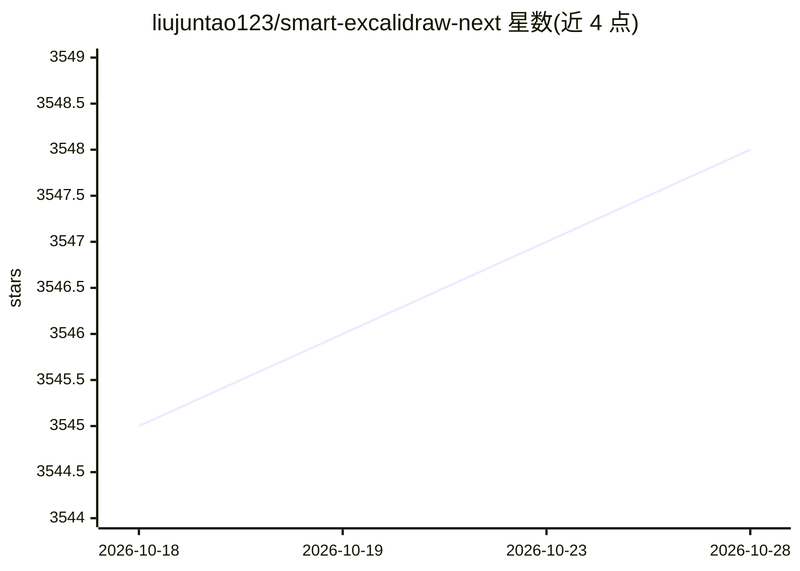

# liujuntao123/smart-excalidraw-next

⭐ 3,547 · JavaScript · 推送 2026-10-12 · [GitHub](https://github.com/liujuntao123/smart-excalidraw-next) · [官网](https://ai-draw-nexus.aizhi.site) · 个人维护 · 中文 README

**用自然语言生成 Excalidraw 专业图表的 Web 应用**

基于 Next.js 16/React 19/Excalidraw 的在线绘图应用：用户输入自然语言描述，由 LLM（支持 OpenAI/Anthropic 提供商）生成流程图、架构图、ER 图等 20+ 种图表，输出为 Excalidraw 格式可在画布上继续编辑。配置自己的 API Key 即可使用，配置保存在浏览器本地；服务器管理员也可通过访问密码提供统一 LLM 配置供团队使用。提供本地 git clone 部署方式与在线站点。

## 筛选速览

| 维度 | 判定 | 备注 |
|---|---|---|
| AI 角色 | `ai-native` | 本体是模型或模型工具 |
| 许可风险 | `none` | — |
| 部署形态 | `None` |  |
| 模型依赖 | — | README 未给出锁定关系 |
| 硬件要求 | — | 无带数字的原话,不猜 |
| 安装摩擦 | `low` | 无编译、无系统依赖或容器化 |
| 成熟度 | — | 结构信号不足 |

## 能力要点

- 自然语言生成 20+ 种图表（流程图、ER 图、思维导图等）
- 输出为 Excalidraw 格式，可在画布上继续编辑
- 支持 OpenAI 与 Anthropic 提供商，配置存于浏览器本地
- 服务器端访问密码机制，为团队提供统一 LLM 配置

## 适用场景

- 用一句话生成流程图或架构图
- 团队内部共用统一 LLM 配置绘制图表
- AI 生成后手动精修图表细节

## 场景标签

`代码生成` · 领域:编码与开发

## 证据(README 行号)

> L24: 通过先进的大语言模型理解你的需求，生成结构清晰、布局合理的专业级图表。
> L30: 支持 20+ 种图表类型，包括流程图、架构图、时序图、ER 图、思维导图等。也可以让AI根据你的描述自动选择最合适的图表类型。

## 星数曲线

2026-10-18 3,545 → 2026-10-28 3,548（+3）

---
*卡片 v1 · prompt 1.4 · 生成 2026-10-20 · 置信度 high · 依据 README sha `06f9230645b4` · [字段定义](../../DATASET.md)*
