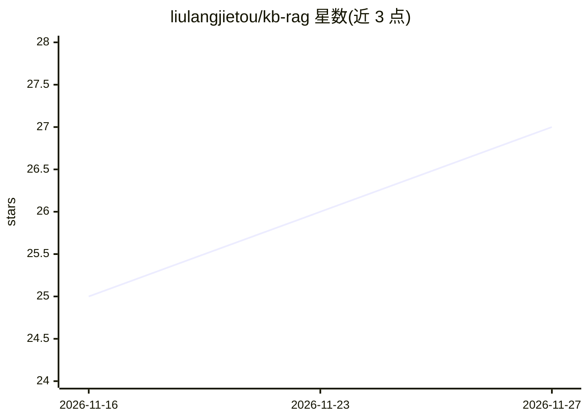

# liulangjietou/kb-rag

⭐ 27 · Java · Apache-2.0 · 推送 2026-11-26 · [GitHub](https://github.com/liulangjietou/kb-rag) · 个人维护 · 中文 README

**自托管企业知识库/RAG 系统：文档接入、混合检索与有据问答**

面向企业的自托管知识库与 RAG 平台：支持文件/聊天记录/网页/S3/OSS/Confluence 接入，双解析实现（Java/Python 二选一）输出 Markdown 与图片；检索采用 BM25+向量混合，可选图路与图片检索、多库路由、融合重排与引用诊断；应用发布带版本比较、评测门禁、快照与回滚；另含 Agent 长期记忆、多租户/RBAC/SSO，经 REST/MCP 对外。工程含 Spring Boot 主服务、React 管理台与部署模板，通过 Docker Compose 编排 MySQL/ES/MinIO 等中间件，模型调用依赖 DASHSCOPE_API_KEY（零 Key 下仅 BM25 检索可用）。

## 筛选速览

| 维度 | 判定 | 备注 |
|---|---|---|
| AI 角色 | `ai-native` | 本体是模型或模型工具 |
| 许可风险 | `permissive` | Apache-2.0 |
| 部署形态 | `self-host` | docker 或自建部署 |
| 模型依赖 | — | README 未给出锁定关系 |
| 硬件要求 | — | 无带数字的原话,不猜 |
| 安装摩擦 | `low` | 无编译、无系统依赖或容器化 |
| 成熟度 | — | 结构信号不足 |

## 能力要点

- BM25+向量混合检索，可选图路/图片检索与多库路由、融合重排
- 文档接入含清洗脱敏、父子切分、多模态索引，双解析实现二选一部署
- 应用发布带版本比较、评测门禁、快照发布与回滚
- REST/MCP 对外接入，多租户/RBAC/文档 ACL/Token 配额

## 适用场景

- 企业内部知识库问答，员工经授权使用带原文引用的回答
- 外部系统经 REST/MCP 接入检索与记忆库能力
- 对知识库应用做评测门禁与质量回归后发布

## 场景标签

`RAG` `文档问答` `Agent 记忆` `模型评测` · 领域:Agent 开发

## 证据(README 行号)

> L18: 可自托管的企业知识库与 RAG 系统，提供文档接入、混合检索、有据问答、评测发布与 Agent 长期记忆。
> L36: |检索与回答|BM25 + 向量、可选图路 / 图片检索、多库路由、融合与重排、引用与诊断、非流式 / SSE 问答|

## 星数曲线

2026-11-16 25 → 2026-11-27 27（+2）

---
*卡片 v1 · prompt 1.4 · 生成 2026-11-18 · 置信度 mid · 依据 README sha `4a34701df735` · [字段定义](../../DATASET.md)*
