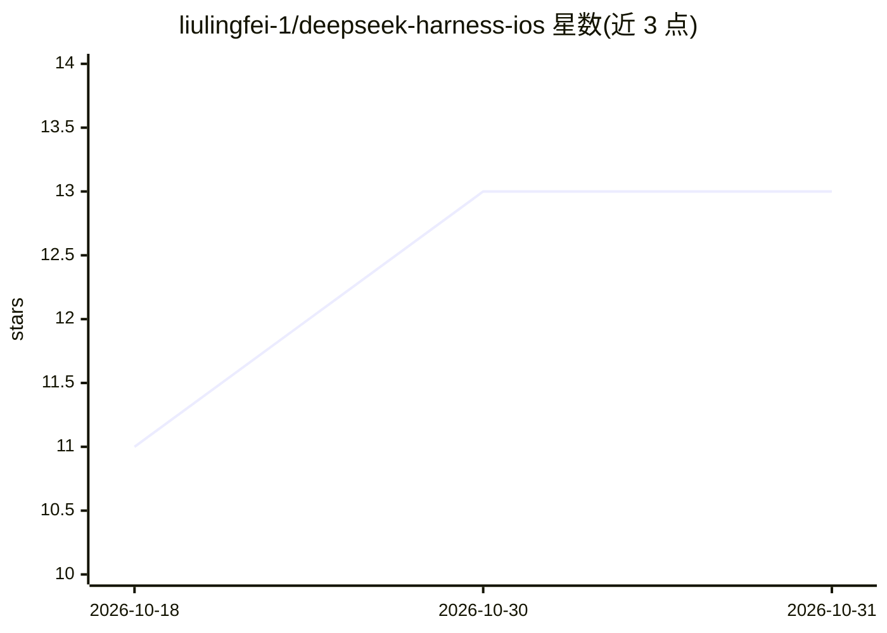

# liulingfei-1/deepseek-harness-ios

⭐ 13 · Swift · GPL-3.0 · 推送 2026-09-13 · [GitHub](https://github.com/liulingfei-1/deepseek-harness-ios) · 个人维护 · 中文 README

**iPhone 原生 DeepSeek Harness Agent 客户端：BYOK 推理+本机工具执行**

原生 SwiftUI iOS Agent 客户端，把桌面 DeepSeek Harness 的 Agent 工作流移植到手机：模型推理由用户自带的 DeepSeek/OpenAI-compatible/Anthropic API 完成（BYOK，Key 存 iOS Keychain），Agent loop、文件工作区、轨迹、iOS 原生工具（照片 OCR、位置、日历等）、Cordis Host-half 插件与 Linux 命令（内嵌 iSH ARM64 Alpine guest）默认在设备本机执行，明确不提供远程命令执行回退。面向个人 Xcode 侧载与开发调试，自述为实验性项目，非 App Store 发行版，也非官方客户端。

## 筛选速览

| 维度 | 判定 | 备注 |
|---|---|---|
| AI 角色 | `ai-native` | 本体是模型或模型工具 |
| 许可风险 | `viral` | GPL-3.0 |
| 部署形态 | `None` |  |
| 模型依赖 | locked-api |  |
| 硬件要求 | — | 无带数字的原话,不猜 |
| 安装摩擦 | `low` | 无编译、无系统依赖或容器化 |
| 成熟度 | `idea` | |

## 能力要点

- BYOK 模型层：DeepSeek、OpenAI-compatible SSE、Anthropic Messages 适配，模型与 Key 可按会话选择
- 本机行动层：iOS 原生工具（相机/照片 OCR、位置、通知、日历等）+ 内嵌 iSH ARM64 Alpine 执行 Linux 命令
- Cordis Host-half JavaScript 插件：市场/GitHub/ZIP 安装、动态 Tool/Prompt、generation/rollback 更新
- append-only 轨迹（run/turn/step、耗时、脱敏日志）与诊断导出

## 适用场景

- 在 iPhone 上用我自己的模型 API 运行完整 Agent 工作流（工具调用、工作区、轨迹）
- 让 Agent 使用手机本地能力（照片 OCR、日历、文件）而不依赖远程执行
- 在手机上安装并运行 Cordis Host-half 插件扩展 Agent 能力

## 场景标签

`AI 助手` · 领域:对话与助手

## 证据(README 行号)

> L17: Harness Mobile 不是网页壳，也不会把命令悄悄转发到服务器。它是一个原生 SwiftUI Agent 客户端：模型推理由用户配置的 HTTPS API 完成；Agent loop、文件工作区、会话、轨迹、iOS 工具、
> L35: - **BYOK 模型层**：DeepSeek、OpenAI-compatible 与 Anthropic 请求适配；模型与 API Key 可按会话选择。

## 星数曲线

2026-10-18 11 → 2026-10-31 13（+2）

---
*卡片 v1 · prompt 1.4 · 生成 2026-10-31 · 置信度 high · 依据 README sha `0c086ee90271` · [字段定义](../../DATASET.md)*
