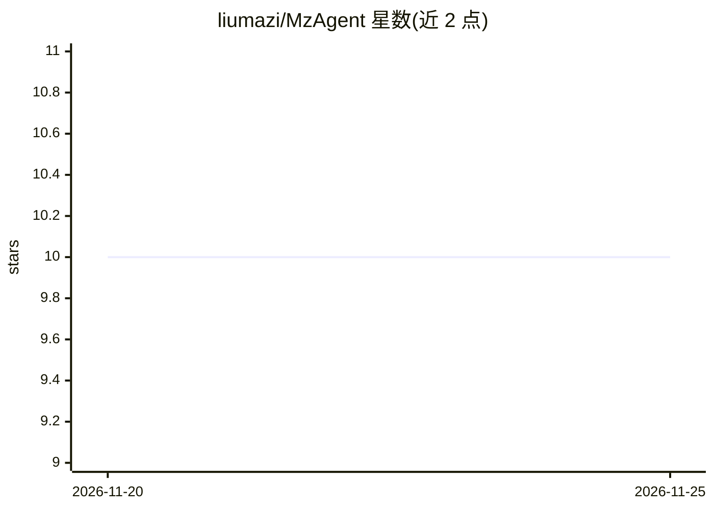

# liumazi/MzAgent

⭐ 10 · Pascal · 推送 2026-05-14 · [GitHub](https://github.com/liumazi/MzAgent) · 个人维护 · 中文 README

**Delphi 编写的 ReAct 模式 AI Agent 学习示例**

以 Delphi/Pascal 实现的 ReAct 模式 Agent：通过调用大语言模型 API 分解并执行用户任务，包含 TReActAgent（API 通信、消息历史管理、输出解析）、工具管理器（read_file/write_to_file/run_terminal_command 三个内置工具）与系统提示词模板，按 XML 标签格式循环执行思考-行动-观察流程，含异常与错误处理。由 MarkTechStation/VideoCode 示例转换而来，面向学习场景。

## 筛选速览

| 维度 | 判定 | 备注 |
|---|---|---|
| AI 角色 | `ai-native` | 本体是模型或模型工具 |
| 许可风险 | `none` | — |
| 部署形态 | `None` |  |
| 模型依赖 | locked-api |  |
| 硬件要求 | — | 无带数字的原话,不猜 |
| 安装摩擦 | `low` | 无编译、无系统依赖或容器化 |
| 成熟度 | — | 结构信号不足 |

## 能力要点

- ReAct 循环：thought/action/observation XML 格式驱动
- 内置三个工具：读文件、写文件、执行终端命令
- 使用 DeepSeek API，地址可配置
- Pascal 源码呈现完整调用流程

## 适用场景

- 学习 ReAct 模式的工作流程与消息格式设计
- 在 Delphi 项目中接入 LLM 驱动的工具调用
- 参考其提示词模板实现自己的 Agent

## 场景标签

`教程课程` · 领域:学习与行业

## 证据(README 行号)

> L5: MzAgent 是一个基于 ReAct (Reasoning + Acting) 模式的 AI Agent，通过调用大语言模型来分解和执行用户任务。
> L53: - 使用 DeepSeek API（可配置）

## 星数曲线

2026-11-20 10 → 2026-11-25 10（+0）

---
*卡片 v1 · prompt 1.4 · 生成 2026-11-20 · 置信度 high · 依据 README sha `e6e1536007da` · [字段定义](../../DATASET.md)*
