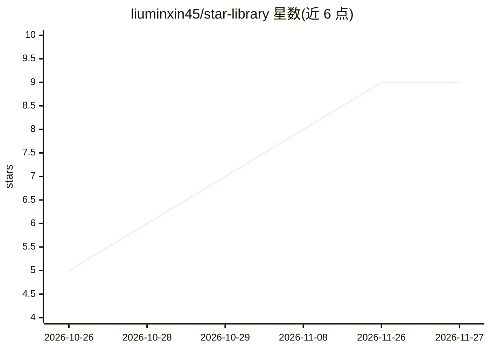

# liuminxin45/star-library

⭐ 9 · C · MIT · 推送 2026-11-03 · [GitHub](https://github.com/liuminxin45/star-library) · [官网](https://www.liuminxin.cn/works/star-library) · 个人维护 · 中文 README

**给 GitHub 收藏者的本地星标管理器：中文概括与发现**

Windows 原生的 GitHub Stars 管理器，用 Win32/Direct2D 实现为单文件 exe（约 167 KB）。核心功能：用自有 Token 同步收藏到本机形成可搜索项目库，支持按语言筛选、排序、JSON 导入导出、离线浏览与增量同步续接；可选接入兼容 Chat Completions 的模型服务，生成项目中文概括、兴趣画像与项目发现推荐。不内置模型额度，AI 不配置时同步、搜索、浏览功能仍可用。仅支持 Windows 10/11。

## 筛选速览

| 维度 | 判定 | 备注 |
|---|---|---|
| AI 角色 | `ai-enhanced` | 去掉 AI 部分产品仍成立 |
| 许可风险 | `permissive` | MIT |
| 部署形态 | `desktop` | 安装包/桌面程序 |
| 模型依赖 | — | README 未给出锁定关系 |
| 硬件要求 | — | 无带数字的原话,不猜 |
| 安装摩擦 | `low` | 无编译、无系统依赖或容器化 |
| 成熟度 | — | 结构信号不足 |

## 能力要点

- 单文件 exe 免安装，仅依赖 Windows 系统 DLL
- 本地项目库支持搜索、语言筛选、JSON 导入导出与离线浏览
- 可选 AI 生成中文概括、兴趣画像与项目发现推荐
- 增量整理逐项保存，失败/取消/重启后可续接

## 适用场景

- 找回和整理积累的 GitHub 收藏
- 用中文概括快速了解收藏项目用途
- 根据兴趣画像发现新的实用工具

## 场景标签

`知识库管理` · 领域:知识与检索

## 证据(README 行号)

> L25: 它不提供内置模型额度。AI 会把相关项目资料发给你配置的服务，费用与数据处理方式由该服务决定；不配置 AI 也能同步、搜索和浏览收藏。
> L31: |收藏太多，忘了项目是做什么的|AI 生成中文概括，在卡片中直接查看；没有概括时显示原始 About|
> L83: 目前只支持 Windows 10/11，界面及 AI 概括以中文为主。

## 星数曲线

2026-10-26 5 → 2026-11-27 9（+4）

---
*卡片 v1 · prompt 1.4 · 生成 2026-11-20 · 置信度 high · 依据 README sha `0322708c401c` · [字段定义](../../DATASET.md)*
