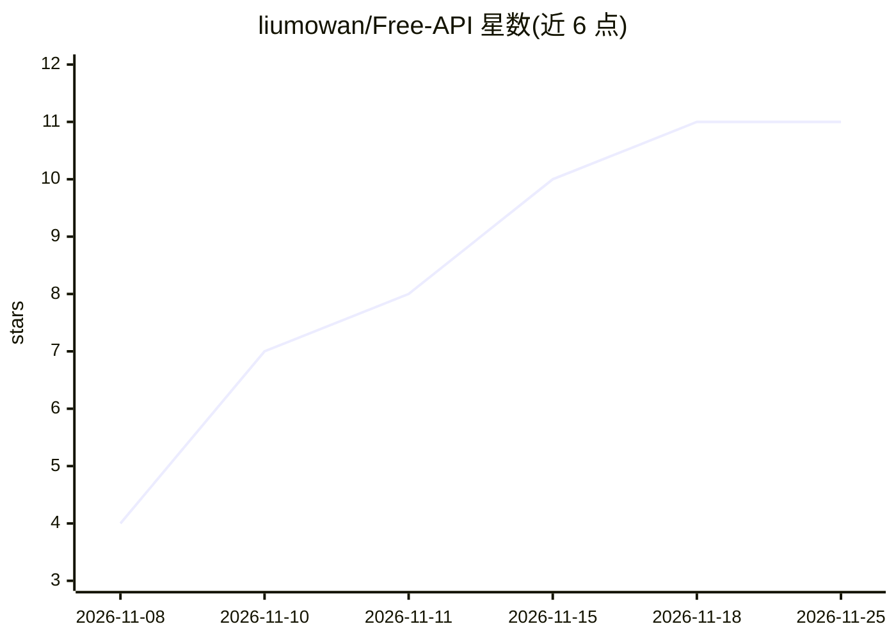

# liumowan/Free-API

⭐ 11 · JavaScript · MIT · 推送 2026-11-21 · [GitHub](https://github.com/liumowan/Free-API) · [官网](https://liumowan.github.io/Free-API/) · 个人维护 · 中文 README

**免费 AI API 中转站清单：注册送额度、签到续命的资源目录**

汇总提供免费额度的 AI 大模型 API 渠道，按签到型中转站、注册送额型、官方免费额度、自建网关四类组织，每条含注册链接、额度规则、可用模型与注册限制。附带风险提示（隐私、跑路、计价单位）、Claude Code/Codex/Cursor 等客户端接入示例（OpenAI/Anthropic 协议）、避坑清单与 FAQ。额度数字由维护者人工核验并标注核验日期，站方规则变动不实时同步。

## 筛选速览

| 维度 | 判定 | 备注 |
|---|---|---|
| AI 角色 | `ai-knowledge` | 知识聚合/清单类 |
| 许可风险 | `permissive` | MIT |
| 部署形态 | `self-host` | docker 或自建部署 |
| 模型依赖 | — | README 未给出锁定关系 |
| 硬件要求 | — | 无带数字的原话,不猜 |
| 安装摩擦 | `low` | 无编译、无系统依赖或容器化 |
| 成熟度 | — | 结构信号不足 |

## 能力要点

- 收录签到型、注册送额型中转站与国内外官方免费额度平台
- 提供 OpenAI 与 Anthropic 协议的客户端接入配置示例
- 给出 Docker 一键启动 New-API 的自建网关方案
- 标注每站核验日期、注册限制（如 Linux Do 信任等级）

## 适用场景

- 个人学习实验想找免费额度的大模型 API
- 给 Claude Code、Cursor 等客户端配置低成本接入
- 想自建 API 网关聚合多家免费渠道

## 场景标签

`精选清单` · 领域:学习与行业

## 证据(README 行号)

> L1: # Free API · 免费 AI 大模型 API 中转站合集
> L3: > 这里整理「注册就送额度、隔天还能签到续」的 AI API 中转站。
> L43: ## 一、签到型中转站（额度能续，最耐用）

## 星数曲线

2026-11-08 4 → 2026-11-25 11（+7）

---
*卡片 v1 · prompt 1.4 · 生成 2026-11-18 · 置信度 mid · 依据 README sha `21bed228fadd` · [字段定义](../../DATASET.md)*
