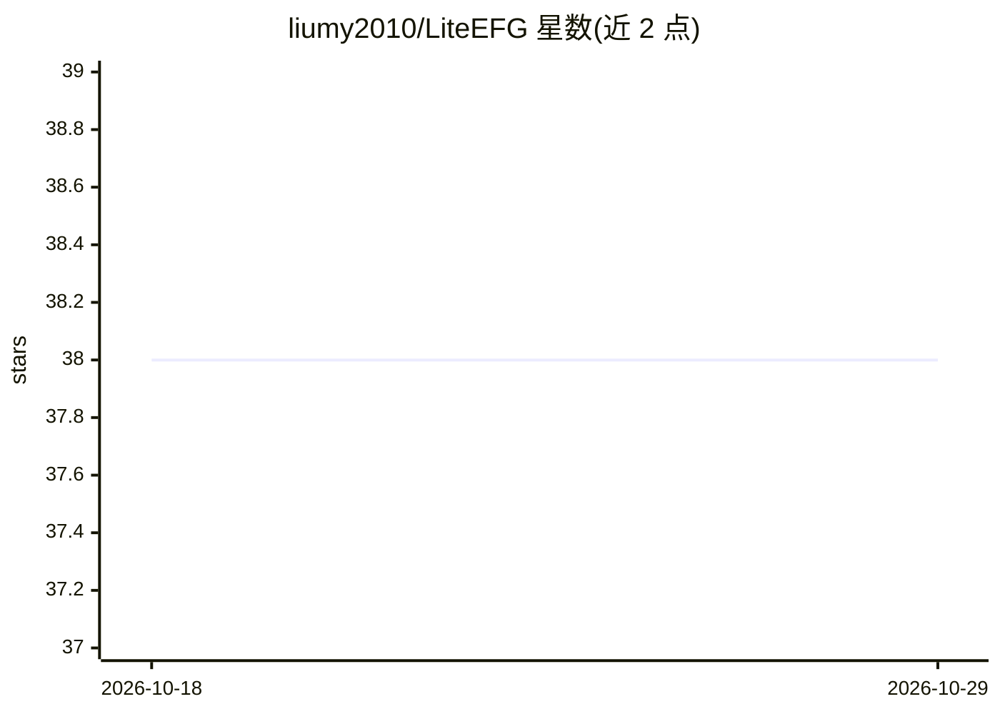

# liumy2010/LiteEFG

⭐ 38 · Python · MIT · 推送 2026-10-01 · [GitHub](https://github.com/liumy2010/LiteEFG) · 组织维护

**求解扩展式博弈的 Python 库，实现 CFR 等基线算法**

Python 接口、C++/JAX 后端的扩展式博弈求解库：在 Python 中定义单个信息集上的更新规则，库在整个博弈树上求值计算图并维护各信息集的值。内置表格型求解器与深度强化学习支持（JAX/Optax/Flax，含 PPO），支持自定义 C++ 环境（CppEnv）、原生 C++ 线程与多设备并行。面向博弈论与强化学习研究者，附 arXiv 论文（2407.20351），MIT 许可。需 Python 3.10+，源码构建需支持 C++17 的编译器。

## 筛选速览

| 维度 | 判定 | 备注 |
|---|---|---|
| AI 角色 | `ai-native` | 本体是模型或模型工具 |
| 许可风险 | `permissive` | MIT |
| 部署形态 | `library` | 以包/库形式分发 |
| 模型依赖 | — | README 未给出锁定关系 |
| 硬件要求 | — | 无带数字的原话,不猜 |
| 安装摩擦 | `low` | 无编译、无系统依赖或容器化 |
| 成熟度 | — | 结构信号不足 |

## 能力要点

- 按信息集定义更新规则，库自动在整个博弈树上求值计算图
- 内置 CFR 等基线算法与 Kuhn poker 快速上手示例
- 基于 JAX/Optax/Flax 的 DRL 训练（含 PPO）
- CppEnv 自定义游戏与 C++ 多线程、多设备并行加速

## 适用场景

- 在 Kuhn poker 等博弈上运行 CFR 等基线求解算法
- 研究者定义并评估自己的博弈求解更新规则
- 用 DRL 训练神经博弈求解策略并做并行实验

## 场景标签

`强化学习` · 领域:训练与推理

## 证据(README 行号)

> L3: - **Deep Reinforcement Learning (DRL) support** — Train neural game-solving algorithms with JAX, including Proximal 
> L13:  A Python interface backed by C++ and JAX for solving extensive-form games.
> L25: Define an algorithm’s update rule in Python for a single information set. LiteEFG evaluates the resulting computati

## 星数曲线

2026-10-18 38 → 2026-10-29 38（+0）

---
*卡片 v1 · prompt 1.4 · 生成 2026-10-25 · 置信度 high · 依据 README sha `51b8daf74743` · [字段定义](../../DATASET.md)*
