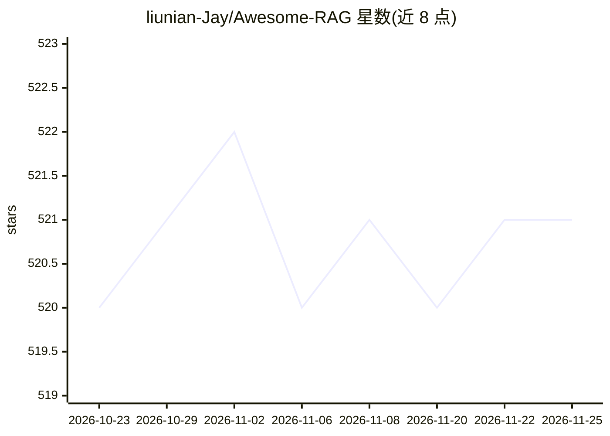

# liunian-Jay/Awesome-RAG

⭐ 521 · 推送 2026-11-23 · [GitHub](https://github.com/liunian-Jay/Awesome-RAG) · 个人维护 · 中文 README

**RAG 论文进展清单：按月份收录论文、数据集与综述**

面向研究者的检索增强生成（RAG）资源清单：按年月组织收录 2024-2026 年 RAG 相关论文条目，设 Top 会议录用论文专栏（NIPS/EMNLP/ACL/ICML/ICLR），并整理评测数据集（HotpotQA、2WikiMultiHopQA、SQuAD 等）与 Survey 列表、相关开源项目链接。README 声明近期未积极维护，欢迎贡献者接管；欢迎研究者通过 PR 提交自己论文的信息。

## 筛选速览

| 维度 | 判定 | 备注 |
|---|---|---|
| AI 角色 | `ai-knowledge` | 知识聚合/清单类 |
| 许可风险 | `none` | — |
| 部署形态 | `None` |  |
| 模型依赖 | — | README 未给出锁定关系 |
| 硬件要求 | — | 无带数字的原话,不猜 |
| 安装摩擦 | `low` | 无编译、无系统依赖或容器化 |
| 成熟度 | — | 结构信号不足 |

## 能力要点

- 按年月组织的 RAG 论文收录（2024-2026）
- NIPS/EMNLP/ACL/ICML/ICLR 录用论文专栏
- 整理 HotpotQA、SQuAD 等 RAG 评测数据集
- Survey 综述与相关开源项目（LightRAG/RAGFlow 等）链接

## 适用场景

- 跟踪 RAG 领域最新论文进展
- 为 RAG 研究选择评测数据集
- 查找 RAG 相关综述文献

## 场景标签

`精选清单` `科研工具` · 领域:学习与行业

## 证据(README 行号)

> L6: 💡 List of recent developments in Retrieval-Augmented Generation (RAG) for large language models (LLM).
> L43: ### 🗃️ Evaluation Datasets
> L82: ## 🔥Latest Papers

## 星数曲线

2026-10-23 520 → 2026-11-25 521（+1）

---
*卡片 v1 · prompt 1.4 · 生成 2026-11-25 · 置信度 high · 依据 README sha `d1a1ec94b879` · [字段定义](../../DATASET.md)*
