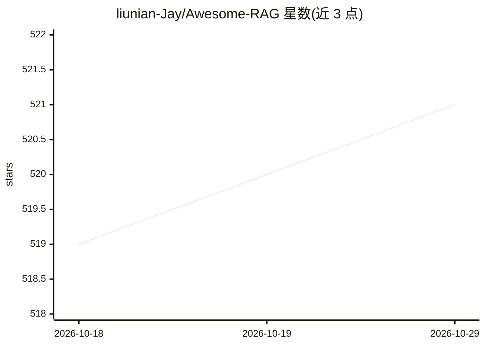

# liunian-Jay/Awesome-RAG

⭐ 521 · 推送 2026-10-25 · [GitHub](https://github.com/liunian-Jay/Awesome-RAG) · 组织维护

**RAG 领域论文与资源追踪清单（面向研究者）**

按年份与月份收录 RAG 相关论文的追踪清单：覆盖 NIPS/EMNLP/ACL/ICML/ICLR 等会议论文，2024-2026 年逐月更新条目，另含综述论文链接、相关项目（LightRAG/RAGFlow 等）、评测数据集列表，以及维护者自身的 CoCoA/GainRAG/QAgent 等工作动态。仓库声明近期未积极维护并欢迎接手者。面向 RAG 方向研究人员，通过 PR 提交更新。

## 筛选速览

| 维度 | 判定 | 备注 |
|---|---|---|
| AI 角色 | `ai-knowledge` | 知识聚合/清单类 |
| 许可风险 | `none` | — |
| 部署形态 | `None` |  |
| 模型依赖 | — | README 未给出锁定关系 |
| 硬件要求 | — | 无带数字的原话,不猜 |
| 安装摩擦 | `low` | 无编译、无系统依赖或容器化 |
| 成熟度 | — | 结构信号不足 |

## 能力要点

- 按年月组织的 RAG 论文条目（2024-2026）
- 收录 RAG 综述论文与评测数据集清单
- 跟踪维护者团队论文（CoCoA/GainRAG 等）并附代码链接

## 适用场景

- 追踪 RAG 领域最新论文动态
- 查找 RAG 综述与评测数据集
- 了解 RAG 相关开源项目与研究团队工作

## 场景标签

`RAG` `精选清单` · 领域:知识与检索

## 证据(README 行号)

> L6: 💡 List of recent developments in Retrieval-Augmented Generation (RAG) for large language models (LLM).
> L63: ### 🎁 Resources

## 星数曲线

2026-10-18 519 → 2026-10-29 521（+2）

---
*卡片 v1 · prompt 1.4 · 生成 2026-10-21 · 置信度 high · 依据 README sha `14d5159eeca6` · [字段定义](../../DATASET.md)*
