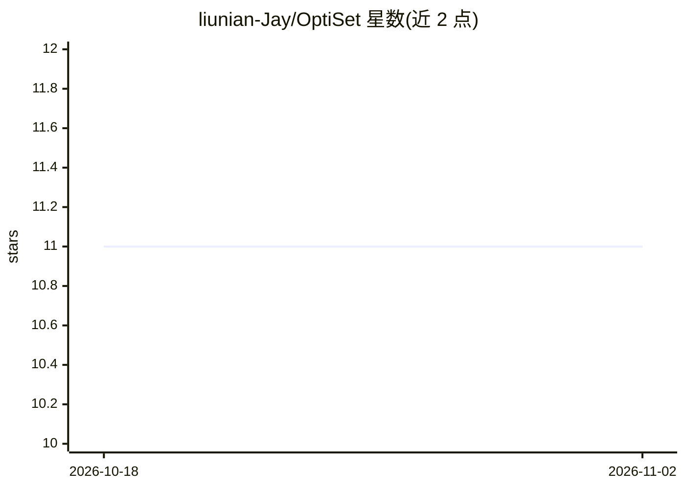

# liunian-Jay/OptiSet

⭐ 11 · 推送 2026-01-09 · [GitHub](https://github.com/liunian-Jay/OptiSet) · 组织维护 · 中文 README

**RAG 证据集合选择与排序的统一优化框架（论文代码）**

EMNLP 2026 论文 OptiSet 的代码仓库，作者来自哈尔滨工业大学。提出面向 RAG 的集合中心框架，采用'先扩展后精炼'范式：将查询扩展为多视角构建多样候选池，再通过重选择形成紧凑证据集；设计无强 LLM 监督的自合成策略，从生成器的集合条件效用变化推导偏好标签，识别互补与冗余证据；并以 set-list wise 训练策略联合优化集合选择与集合级排序。README 尚未完成，框架细节标注 TBD。

## 筛选速览

| 维度 | 判定 | 备注 |
|---|---|---|
| AI 角色 | `ai-ecosystem` | LLM/agent 周边工具 |
| 许可风险 | `none` | — |
| 部署形态 | `None` |  |
| 模型依赖 | — | README 未给出锁定关系 |
| 硬件要求 | — | 无带数字的原话,不猜 |
| 安装摩擦 | `low` | 无编译、无系统依赖或容器化 |
| 成熟度 | `idea` | |

## 能力要点

- Expand-then-Refine：查询多视角扩展后重选择形成紧凑证据集
- 自合成策略从生成器效用变化推导偏好标签，无需强 LLM 监督
- set-list wise 训练联合优化集合选择与集合级排序

## 适用场景

- 研究者复现或引用该 RAG 证据选择方法
- RAG 系统中改进检索证据集合的紧凑性与增益
- 了解集合级证据选择与排序的联合优化思路

## 场景标签

`RAG` · 领域:知识与检索

## 证据(README 行号)

> L1: OptiSet: Unified Optimizing Set Selection and Ranking for Retrieval-Augmented Generation
> L20: > we propose OptiSet, a set-centric framework that unifies set selection and set-level ranking for RAG. OptiSet ado

## 星数曲线

2026-10-18 11 → 2026-11-02 11（+0）

---
*卡片 v1 · prompt 1.4 · 生成 2026-11-02 · 置信度 mid · 依据 README sha `0332814470d5` · [字段定义](../../DATASET.md)*
