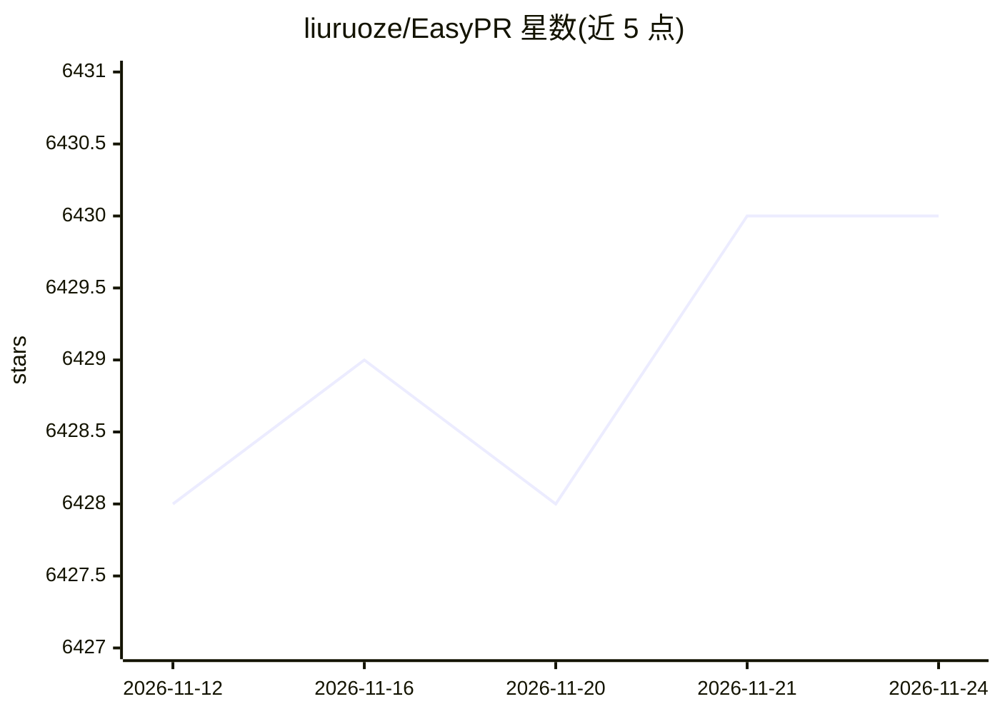

# liuruoze/EasyPR

⭐ 6,432 · C++ · Apache-2.0 · 推送 2026-11-12 · [GitHub](https://github.com/liuruoze/EasyPR) · 个人维护 · 中文 README

**非限制场景下的中文车牌识别开源库**

基于 OpenCV 的 C++ 中文车牌识别库，流水线覆盖车牌定位（CMSER/SOBEL/COLOR 三种定位方法可组合）、车牌判断（SVM）、字符分割与字符识别（ANN），输出车牌颜色与字符字符串（如“蓝牌：苏EUK722”）。识别流程可通过 CPlateRecognize 类的属性配置，并提供批量测试（accuracy）输出 Recall 等指标。附带训练代码（SVM/ANN/中文灰度字符）与训练数据。限制：图片清晰时精度约80%以上，OpenCV 需 3.0 以上版本，Linux 推荐 3.2 以上；不支持新能源车牌与两行车牌。源码 Apache v2.0，测试图片数据 GDSL 协议。

## 筛选速览

| 维度 | 判定 | 备注 |
|---|---|---|
| AI 角色 | `ai-native` | 本体是模型或模型工具 |
| 许可风险 | `permissive` | Apache-2.0 |
| 部署形态 | `None` |  |
| 模型依赖 | — | README 未给出锁定关系 |
| 硬件要求 | — | 无带数字的原话,不猜 |
| 安装摩擦 | `low` | 无编译、无系统依赖或容器化 |
| 成熟度 | — | 结构信号不足 |

## 能力要点

- 支持中文车牌的定位、判断、分割与字符识别全流水线（SVM+ANN）
- 三种车牌定位方法（CMSER/SOBEL/COLOR）可通过位运算组合
- 提供 SVM/ANN/中文灰度字符的训练代码与训练数据
- 跨平台：主仓库整合 Linux/mac，另有 C#/Android/iOS/Java 社区移植版本

## 适用场景

- 在图片中检测并识别中文车牌字符与颜色
- 训练或替换自己的车牌判断与字符识别模型
- 批量测试图片并输出 Recall 等定位评价

## 场景标签

`OCR` · 领域:感知与多模态

## 证据(README 行号)

> L3: EasyPR是一个开源的中文车牌识别系统，其目标是成为一个简单、高效、准确的非限制场景(unconstrained situation)下的车牌识别库。
> L193: | plate_recognize | 车牌识别，是车牌检测与字符识别的共有子类

## 星数曲线

2026-11-12 6,428 → 2026-11-24 6,430（+2）

---
*卡片 v1 · prompt 1.4 · 生成 2026-11-17 · 置信度 high · 依据 README sha `f5c91b504be4` · [字段定义](../../DATASET.md)*
