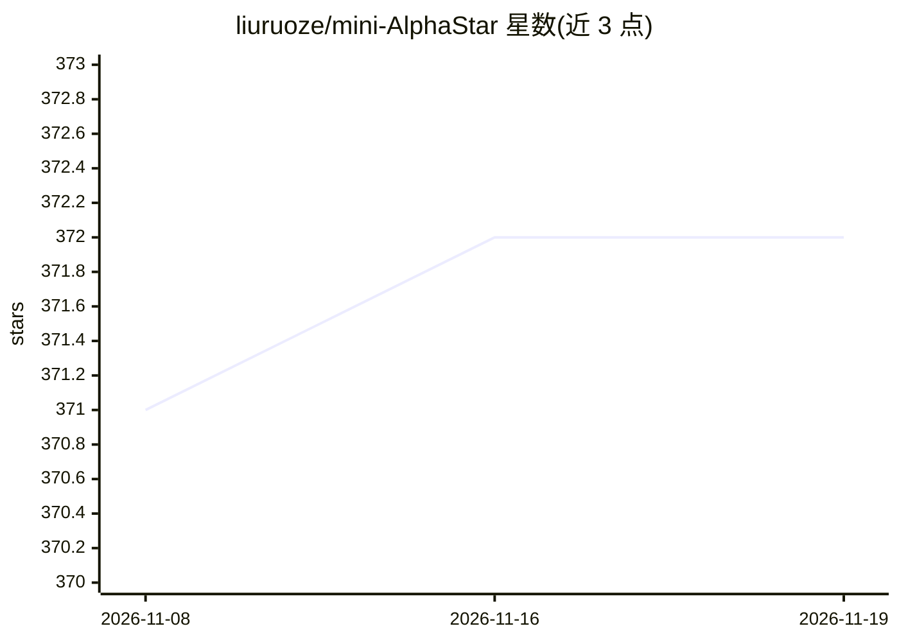

# liuruoze/mini-AlphaStar

⭐ 372 · Python · Apache-2.0 · 推送 2026-11-18 · [GitHub](https://github.com/liuruoze/mini-AlphaStar) · 个人维护 · 中文 README

**AlphaStar 的小规模复现：单机训练 StarCraft II 智能体**

DeepMind AlphaStar 的 mini-scale 复现研究项目，将超参数调整为可在单台商用服务器上训练。本轮更新仅涉及监督学习：在 DAgger（规则专家 v5 标注）自博弈数据中混入 5 个人类 replay，难度 3 严格胜率从 31.2% 提升至 45.6%。含 128 实体架构、三步训练流程、20 标准种子评测脚本，并给出预训练 SL/RL 模型。仅依赖 PyTorch，通过 conda/pip 安装，训练资源消耗高，不推荐笔记本训练。

## 筛选速览

| 维度 | 判定 | 备注 |
|---|---|---|
| AI 角色 | `ai-native` | 本体是模型或模型工具 |
| 许可风险 | `permissive` | Apache-2.0 |
| 部署形态 | `library` | 以包/库形式分发 |
| 模型依赖 | — | README 未给出锁定关系 |
| 硬件要求 | — | 无带数字的原话,不猜 |
| 安装摩擦 | `medium` | 含编译或系统依赖之一 |
| 成熟度 | — | 结构信号不足 |

## 能力要点

- 单台商用服务器可训练的 AlphaStar 小规模复现
- DAgger 规则专家 v5（策略随机抽取、动态选址）生成训练数据
- 混入 5 个人类 replay 后严格胜率 31.2%→45.6%（难度 3，316 局）
- 提供预训练 SL/RL 模型与 20 标准种子评测脚本

## 适用场景

- 在小规模资源上复现和研究 AlphaStar 技术
- 做 StarCraft II 智能体的模仿学习/强化学习实验
- 分析 DAgger 与人类数据混合对训练的影响

## 场景标签

`模型训练` `强化学习` · 领域:训练与推理

## 证据(README 行号)

> L7: The mini-AlphaStar (mini-AS, or mAS) project is a **mini-scale** version of the AlphaStar (AS) program. AlphaStar is
> L9: The "mini-scale" means making the original AS's hyper-parameters **adjustable** so that we can train mini-AS on a **
> L164: **Warning**: SC2 is extremely difficult, and AlphaStar is also very complex. Though our project is a mini-AlphaSta

## 星数曲线

2026-11-08 371 → 2026-11-19 372（+1）

---
*卡片 v1 · prompt 1.4 · 生成 2026-11-17 · 置信度 mid · 依据 README sha `718140f9772c` · [字段定义](../../DATASET.md)*
