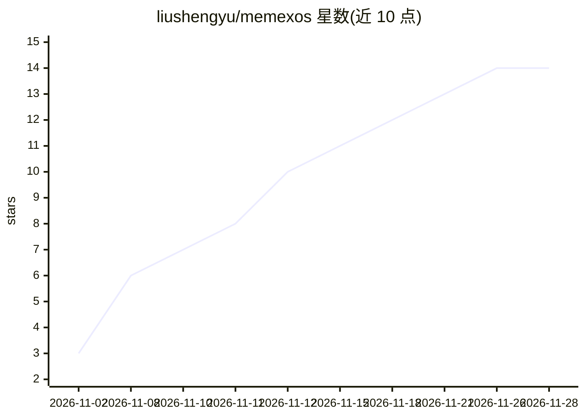

# liushengyu/memexos

⭐ 14 · Python · MIT · 推送 2026-11-23 · [GitHub](https://github.com/liushengyu/memexos) · 个人维护 · 中文 README

**为个人与 AI agent 构建可持续维护的个人知识库（记忆系统）**

源自 Karpathy 的 LLM Wiki 构想：每晚收集用户在 YouTube、Bilibili、X、RSS 等平台保存的内容以及与 agent 的会话结论，由模型编译为带来源链接的 markdown wiki。写入经 staging 副本中的程序检查、自检与异构模型家族的独立审查两道门，每次变更均为可回滚的 git commit。agent 通过 `memex search`/`memex get` 一条命令行检索。写作模型走 Claude Code/Codex 命令行订阅（无需 API key），也可配置 Anthropic/OpenAI 兼容 API 或 Ollama 等本地后端，按角色混用。需 macOS/Linux（Windows 走 WSL）。

## 筛选速览

| 维度 | 判定 | 备注 |
|---|---|---|
| AI 角色 | `ai-ecosystem` | LLM/agent 周边工具 |
| 许可风险 | `permissive` | MIT |
| 部署形态 | `None` |  |
| 模型依赖 | local-ok | 支持本地模型 |
| 硬件要求 | — | 无带数字的原话,不猜 |
| 安装摩擦 | `medium` | 含编译或系统依赖之一 |
| 成熟度 | — | 结构信号不足 |

## 能力要点

- 夜间自动收集多平台内容，本地转录无字幕视频
- 双重审查门：程序检查+异构模型家族独立复核，未通过不入库
- 按模型角色分配后端，配额耗尽自动切换
- 通过使用反馈自我修正并每周 lint，附本地控制台

## 适用场景

- 让 Claude Code/Codex 会话之间共享长期记忆
- 把散落在各平台的收藏沉淀为可检索知识库
- 无人值守运行个人知识库的夜间采集与编译

## 场景标签

`Agent 记忆` `知识库管理` · 领域:Agent 开发

## 证据(README 行号)

> L55: - **Works with any agent and any model.** Agents use one command line (`memex search`, `memex get`). The writing ru
> L33: |Ingest, query, lint|`memex ingest`; `memex search` and `memex get` for any agent; a weekly lint; and fixes driven 
> L56:  Claude Code, Codex, the Anthropic API, any OpenAI-compatible API, or a local model (Ollama, LM Studio, vLLM), mixe

## 星数曲线

2026-11-02 3 → 2026-11-28 14（+11）

---
*卡片 v1 · prompt 1.4 · 生成 2026-11-18 · 置信度 high · 依据 README sha `8cde8def98fd` · [字段定义](../../DATASET.md)*
