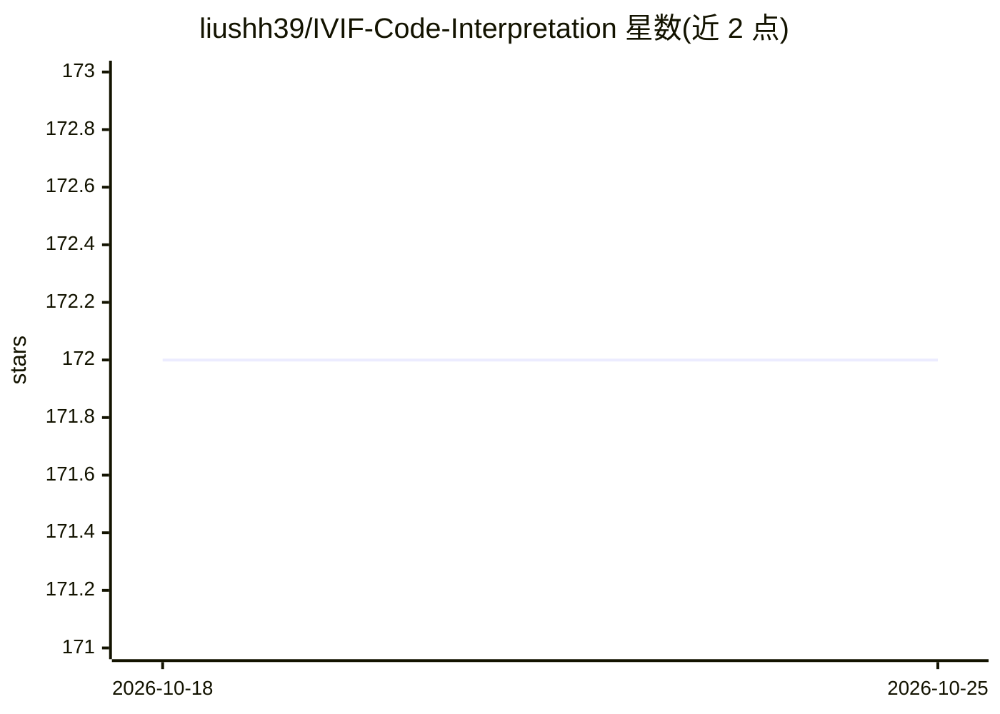

# liushh39/IVIF-Code-Interpretation

⭐ 172 · 推送 2026-09-17 · [GitHub](https://github.com/liushh39/IVIF-Code-Interpretation) · 个人维护 · 中文 README

**面向图像融合研究者的红外-可见光融合方法与代码汇总清单**

持续更新的红外与可见光图像融合（IVIF）开源资源汇总：按年份（2024-2026）和发表会议/期刊（CVPR、AAAI、ICML、ECCV、ACM MM、TPAMI、TIP 等）组织论文与方法条目，收录 50+ 新方法，并包含综述论文列表。面向图像融合与计算机视觉领域的研究者，提供论文、代码、数据集与评测资源的索引。内容以表格形式编排，README 要求转载注明出处。

## 筛选速览

| 维度 | 判定 | 备注 |
|---|---|---|
| AI 角色 | `ai-knowledge` | 知识聚合/清单类 |
| 许可风险 | `none` | — |
| 部署形态 | `None` |  |
| 模型依赖 | — | README 未给出锁定关系 |
| 硬件要求 | — | 无带数字的原话,不猜 |
| 安装摩擦 | `low` | 无编译、无系统依赖或容器化 |
| 成熟度 | — | 结构信号不足 |

## 能力要点

- 按发表 venue 与年份组织的 IVIF 方法条目表格
- 收录 2026 年 CVPR/AAAI/ICML 等会议 50+ 方法
- 包含 2023-2024 年中英文综述论文列表
- 持续更新，含论文、代码、数据集与评测资源

## 适用场景

- 查找红外-可见光融合方向的最新论文与开源代码
- 了解 IVIF 领域各会议期刊的方法分布
- 获取该领域的综述与数据集评测资源入口

## 场景标签

`精选清单` · 领域:学习与行业

## 证据(README 行号)

> L4: Provide a summary of open-source deep learning-based infrared and visible image fusion (IVIF) and some vision algori
> L5: (**Survey, Code, Dataset, Evaluation and more**).

## 星数曲线

2026-10-18 172 → 2026-10-25 172（+0）

---
*卡片 v1 · prompt 1.4 · 生成 2026-10-22 · 置信度 high · 依据 README sha `d3356b5fdde6` · [字段定义](../../DATASET.md)*
