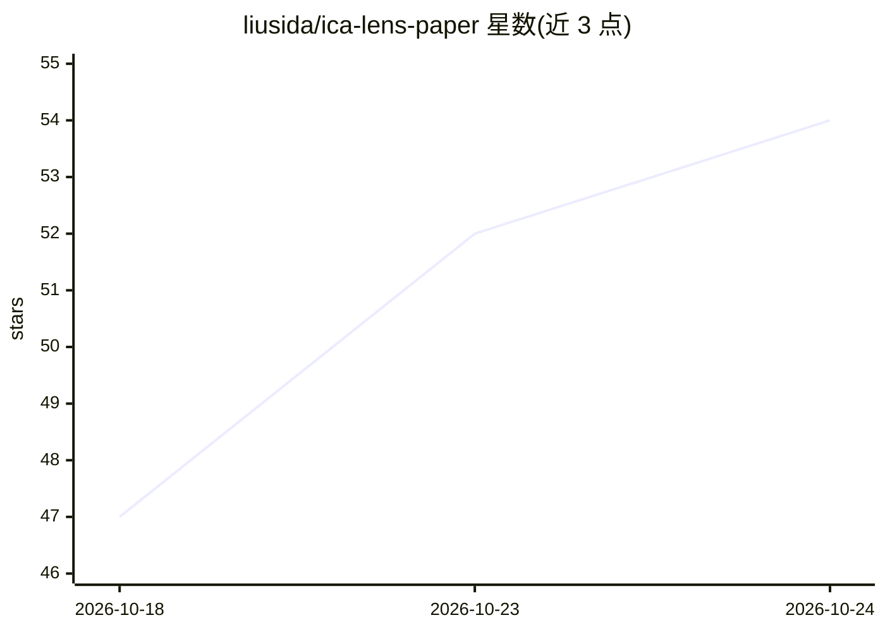

# liusida/ica-lens-paper

⭐ 55 · Python · MIT · 推送 2026-10-24 · [GitHub](https://github.com/liusida/ica-lens-paper) · [官网](https://liusida.github.io/ica-lens-paper/) · 组织维护 · 中文 README

**用 ICA 解释语言模型激活的可解释性工具库**

论文配套代码发布的 Python 库：以独立成分分析（ICA）拟合语言模型激活的组件字典，用于 token 级激活分析与可视化，支持基础模型与指令微调模型（含对话格式）。提供交互式 Jupyter 视图与独立 HTML 导出、基于 ICA 分数偏移的生成引导（steering）、组件画像（符号统计/高分样例/Logit Lens tokens），可拟合新 Lens 并发布到 Hugging Face。自带 PyTorch FastICA 实现，不依赖 SciPy 或 scikit-learn。组件标签与符号需针对具体 Lens 实证确定。

## 筛选速览

| 维度 | 判定 | 备注 |
|---|---|---|
| AI 角色 | `ai-ecosystem` | LLM/agent 周边工具 |
| 许可风险 | `permissive` | MIT |
| 部署形态 | `library` | 以包/库形式分发 |
| 模型依赖 | — | README 未给出锁定关系 |
| 硬件要求 | — | 无带数字的原话,不猜 |
| 安装摩擦 | `medium` | 含编译或系统依赖之一 |
| 成熟度 | — | 结构信号不足 |

## 能力要点

- ICA 组件字典拟合与 token 级激活分析（Jupyter 交互视图、HTML 导出）
- 基于 ICA 分数偏移/钳位的生成引导（steering）
- 内置 PyTorch FastICA 实现，不依赖 SciPy/scikit-learn，支持分块拟合控制内存
- CLI 覆盖 fit/profile/publish 流程，可发布 Lens 到 Hugging Face

## 适用场景

- 研究者对 LLM 内部激活做 ICA 组件级解释与可视化
- 对指令微调模型的对话过程做激活分析
- 通过 ICA 分数偏移对生成行为做干预实验

## 场景标签

 · 领域:LLM 可解释性研究

## 证据(README 行号)

> L3: ICA Lens interprets language-model activations with Independent Component
> L4: Analysis. It is substantially more compute-efficient to fit than an SAE
> L5: dictionary and supports base and instruction-tuned language models.

## 星数曲线

2026-10-18 47 → 2026-10-24 54（+7）

---
*卡片 v1 · prompt 1.4 · 生成 2026-10-24 · 置信度 high · 依据 README sha `867585831cca` · [字段定义](../../DATASET.md)*
