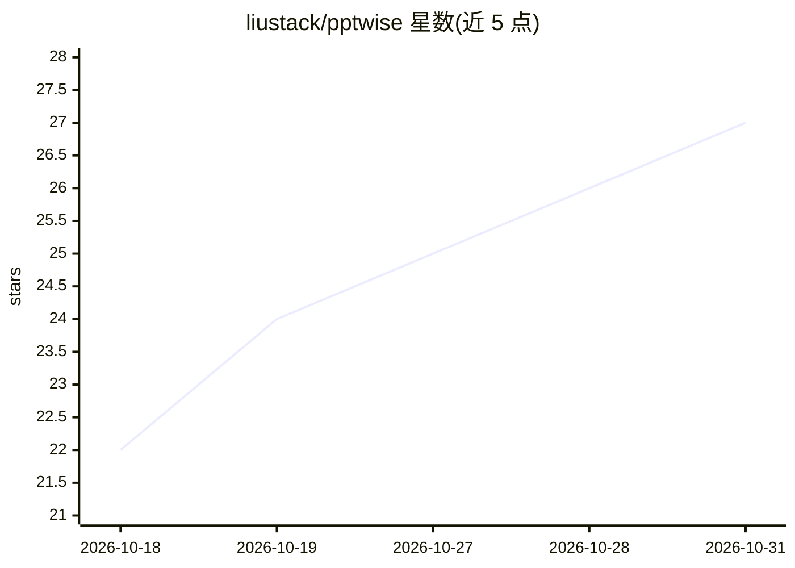

# liustack/pptwise

⭐ 27 · TypeScript · MIT · 推送 2026-10-23 · [GitHub](https://github.com/liustack/pptwise) · [官网](https://pptwise.com) · 个人维护 · 中文 README

**让 AI agent 在本地生成可编辑 PPTX 的渲染引擎与 Agent skill**

以 Agent skill 与 DeepSeek Harness（dsh）插件形式安装的 PPT 生成引擎：agent 依据 IR v5 JSON 描述与语义页面 kind，绑定主题后完全在本地渲染出原生可编辑的 PPTX（每个标题/条目/图表条均为可编辑形状），无需账号与渲染 API key。提供 24 个内置主题，支持复制、fork、从已有 PPTX 提取品牌色字体；附 CLI（validate/render/audit/preview/serve）与浏览器实时预览。限制：图表与表格非原生 PowerPoint 数据对象，改数字需让 AI 重建该页；运行需 Node 22.19+ 或 Bun。

## 筛选速览

| 维度 | 判定 | 备注 |
|---|---|---|
| AI 角色 | `ai-ecosystem` | LLM/agent 周边工具 |
| 许可风险 | `permissive` | MIT |
| 部署形态 | `library` | 以包/库形式分发 |
| 模型依赖 | locked-api |  |
| 硬件要求 | — | 无带数字的原话,不猜 |
| 安装摩擦 | `low` | 无编译、无系统依赖或容器化 |
| 成熟度 | — | 结构信号不足 |

## 能力要点

- IR v5 JSON 到原生可编辑 PPTX 的本地确定性渲染，同一绑定输入输出相同
- 24 个内置主题，支持复制/fork/从企业既有 deck 提取品牌配色与字体
- 一条命令安装进 DeepSeek Harness、Claude Code 或任何读取 skill 目录的 agent
- CLI 提供 validate/assemble/render/audit/preview/serve/doctor 等命令与浏览器实时预览

## 适用场景

- 让 Claude Code / dsh / Codex 等 agent 按我的意图直接做出可继续编辑的 PPT
- 用自然语言反复修订幻灯片并实时预览
- 从公司已有 PPT 提取品牌色和字体生成同风格 deck

## 场景标签

 · 领域:办公文档生成/Agent 工具

## 证据(README 行号)

> L46: **🔌 Installs into the agent you already use.** One command puts PPTwise into DeepSeek Harness, Claude Code, or any 
> L64: There is no step 2. Your AI puts the skill folder where your harness reads it, and the skill brings its own version

## 星数曲线

2026-10-18 22 → 2026-10-31 27（+5）

---
*卡片 v1 · prompt 1.4 · 生成 2026-10-27 · 置信度 high · 依据 README sha `14eca18267bd` · [字段定义](../../DATASET.md)*
