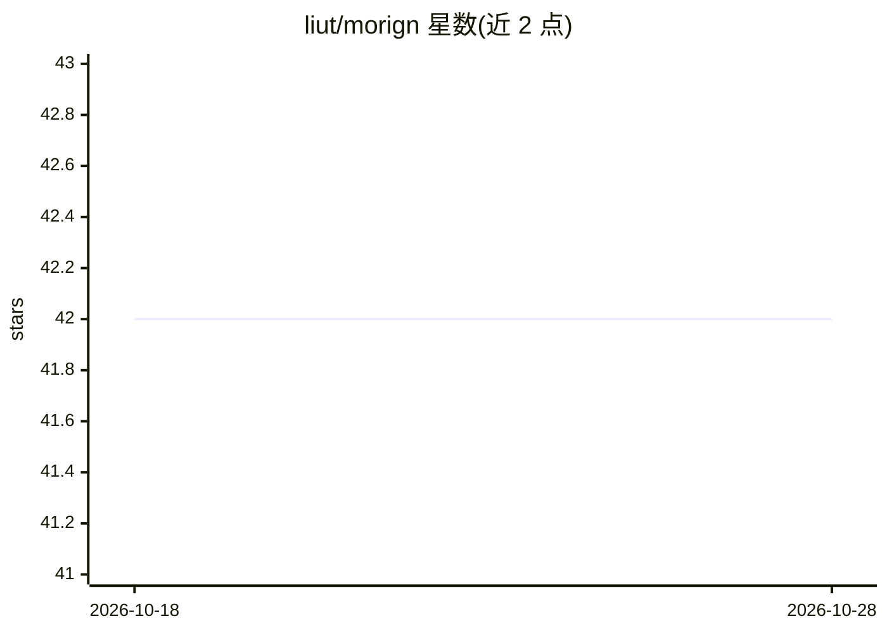

# liut/morign

⭐ 42 · Go · MIT · 推送 2026-10-12 · [GitHub](https://github.com/liut/morign) · 个人维护 · 中文 README

**带知识库问答与 MCP 工具的 AI 聊天后端服务**

用 Go 编写的自托管 AI 聊天后端：从 CSV 导入语料文档，经 Embedding API 生成向量，基于向量检索做知识库问答，可选 LLM 重排；提供 SSE 流式 RESTful API、OAuth2 登录、keeper 角色守卫写操作、内置 MCP 工具支持、技能注入与分层记忆（衰减/强化/遗忘），并适配企业微信与飞书的多通道接入。AI 服务商支持 openai/anthropic/openrouter/ollama 四种类型。依赖 PostgreSQL 与 Redis，配套 Svelte/Vue 前端项目可组合使用。

## 筛选速览

| 维度 | 判定 | 备注 |
|---|---|---|
| AI 角色 | `ai-native` | 本体是模型或模型工具 |
| 许可风险 | `permissive` | MIT |
| 部署形态 | `None` |  |
| 模型依赖 | local-ok | 支持本地模型 |
| 硬件要求 | — | 无带数字的原话,不猜 |
| 安装摩擦 | `low` | 无编译、无系统依赖或容器化 |
| 成熟度 | — | 结构信号不足 |

## 能力要点

- CSV 导入语料 + Embedding 向量化 + 向量检索问答（可选 LLM 重排）
- 内置 MCP 工具支持，agent 工具调用循环上限与结果截断可配
- OAuth2 登录与 keeper 角色守卫写操作端点
- 企业微信/飞书 WebSocket/Webhook 多通道适配

## 适用场景

- 自建带知识库的企业问答聊天服务
- 接入企业微信/飞书做智能助手后端
- 通过 RESTful/SSE API 为自选前端提供 AI 对话能力

## 场景标签

`文档问答` `RAG` `聊天机器人` · 领域:对话与助手

## 证据(README 行号)

> L3: AI chat backend with knowledge base Q&A, MCP tools, and OAuth authentication.
> L9: - High-quality Q&A based on vector search, with optional LLM re-rank
> L205: Supported Provider Type: `openai`, `anthropic`, `openrouter`, `ollama`

## 星数曲线

2026-10-18 42 → 2026-10-28 42（+0）

---
*卡片 v1 · prompt 1.4 · 生成 2026-10-25 · 置信度 high · 依据 README sha `d31bdfe563f8` · [字段定义](../../DATASET.md)*
