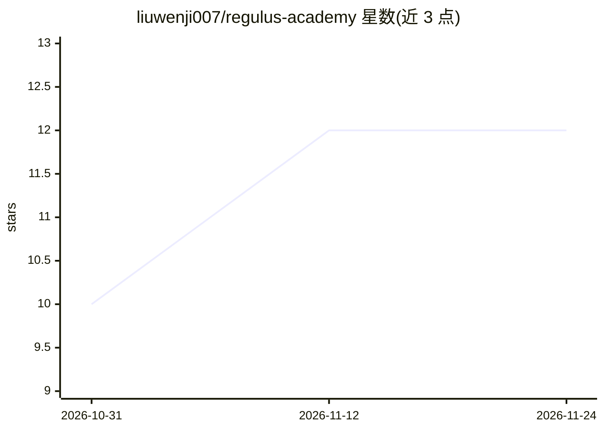

# liuwenji007/regulus-academy

⭐ 12 · Go · Apache-2.0 · 推送 2026-11-12 · [GitHub](https://github.com/liuwenji007/regulus-academy) · [官网](https://regulus-academy-docs.vercel.app/) · 个人维护 · 中文 README

**碎片化学习者的 AI 私教：知识树讲解练习闭环**

自托管的碎片化学习应用：按主题生成有边界的知识树（入门/熟悉/精通分层），对每个节点执行讲解→练习→批改→点亮的闭环，学习画像随对话更新以裁剪讲解与练习。支持 PDF/URL 导入建课、知识图谱可视化、划词答疑、错题强化，可导出 Obsidian 笔记。技术栈为 Go + SQLite + OpenAI 兼容 API，不依赖 Embedding/RAG；提供在线 Demo、Docker 一键部署与源码运行三种方式。

## 筛选速览

| 维度 | 判定 | 备注 |
|---|---|---|
| AI 角色 | `ai-native` | 本体是模型或模型工具 |
| 许可风险 | `permissive` | Apache-2.0 |
| 部署形态 | `None` |  |
| 模型依赖 | — | README 未给出锁定关系 |
| 硬件要求 | — | 无带数字的原话,不猜 |
| 安装摩擦 | `low` | 无编译、无系统依赖或容器化 |
| 成熟度 | — | 结构信号不足 |

## 能力要点

- 讲解→练习→批改→点亮的节点级学习闭环
- PDF/URL 导入建课与知识图谱（星空/目录/星座布局）
- 划词助教答疑，术语与缺口沉淀反哺推荐
- 提供 Docker 一键脚本与 Coach Skill（可装到 Cursor 等 Agent）、IM 接入（Telegram/钉钉/飞书/企微）

## 适用场景

- 下班碎片时间系统入门一个新技术栈
- 把 PDF 资料导入成带练习的知识树课程
- 自托管在本地并跨 Web/IM 继续学习进度

## 场景标签

`知识图谱` `AI 助手` · 领域:对话与助手

## 证据(README 行号)

> L7: > 在碎片时间完成：讲解 → 练习 → 反馈 → 点亮 → 沉淀为可带走的知识。
> L88: 技术选型：Go + SQLite + OpenAI 兼容 API，不必先配 Embedding / RAG。
> L30: 2. **会追着你练完并点亮的教练，不是讲完就走的老师** — 讲解 → 练习 → 批改 → 点亮

## 星数曲线

2026-10-31 10 → 2026-11-24 12（+2）

---
*卡片 v1 · prompt 1.4 · 生成 2026-11-18 · 置信度 high · 依据 README sha `fc4cefcd1103` · [字段定义](../../DATASET.md)*
