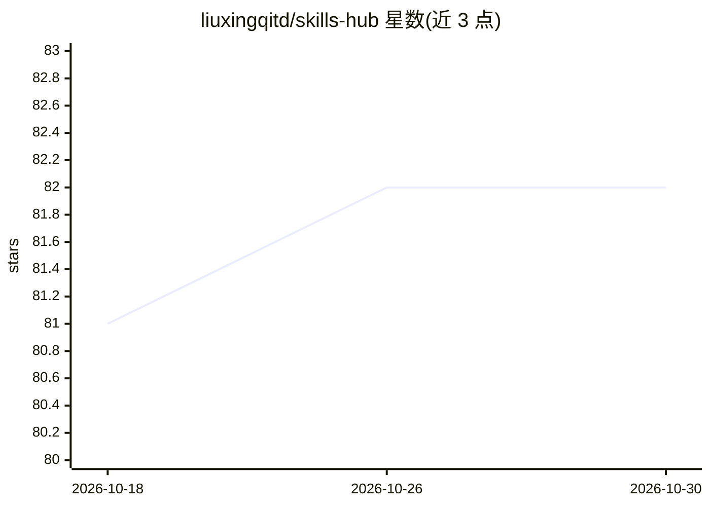

# liuxingqitd/skills-hub

⭐ 82 · TypeScript · MIT · 推送 2026-08-31 · [GitHub](https://github.com/liuxingqitd/skills-hub) · [官网](https://skills-hub.dev) · 个人维护 · 中文 README

**本地桌面面板：统一管理多个 AI 编程 agent 的技能**

基于 Next.js 15 + React 19 + Tauri 2 的本地桌面应用，扫描本机各 AI 编程 agent（OpenClaw、Cursor、Claude Code、Windsurf 等）已安装的技能，在统一面板中展示安装状态，并通过 SHA-256 对比 SKILL.md 内容判定 Synced/Missing/Drifted/Collision/Orphaned 五种状态，支持一键跨 agent 同步、从 GitHub/SSH/本地路径安装新技能、编辑各 agent 的规则文件。无数据库、无云端存储，直接读取本地目录；提供 macOS/Windows 安装包（未签名）与 Web 开发模式。

## 筛选速览

| 维度 | 判定 | 备注 |
|---|---|---|
| AI 角色 | `ai-ecosystem` | LLM/agent 周边工具 |
| 许可风险 | `permissive` | MIT |
| 部署形态 | `desktop` | 安装包/桌面程序 |
| 模型依赖 | — | README 未给出锁定关系 |
| 硬件要求 | — | 无带数字的原话,不猜 |
| 安装摩擦 | `low` | 无编译、无系统依赖或容器化 |
| 成熟度 | — | 结构信号不足 |

## 能力要点

- SHA-256 对比 SKILL.md 判定五种同步状态并一键修复
- 支持从 GitHub 仓库、SSH URL 或本地路径安装技能
- 统一面板编辑各 agent 的规则/指令文件，带实时预览
- agent 无关：通过 config/agents.json 可配置任意 agent

## 适用场景

- 在多个 AI 编程 agent 之间同步和安装技能
- 查看每个 agent 装了哪些技能及同步状态
- 集中编辑各 agent 的全局规则文件

## 场景标签

`提示工程` · 领域:Agent 开发

## 证据(README 行号)

> L3:  A local dashboard to manage AI coding agent skills across multiple agents.
> L34: Skills Hub scans the skills installed by your local AI coding agents and presents everything in a unified dashboard
> L114: Skills Hub is agent-agnostic — configure any agent by editing `config/agents.json`. Out of the box it supports:

## 星数曲线

2026-10-18 81 → 2026-10-30 82（+1）

---
*卡片 v1 · prompt 1.4 · 生成 2026-10-24 · 置信度 high · 依据 README sha `e3e7806e7613` · [字段定义](../../DATASET.md)*
