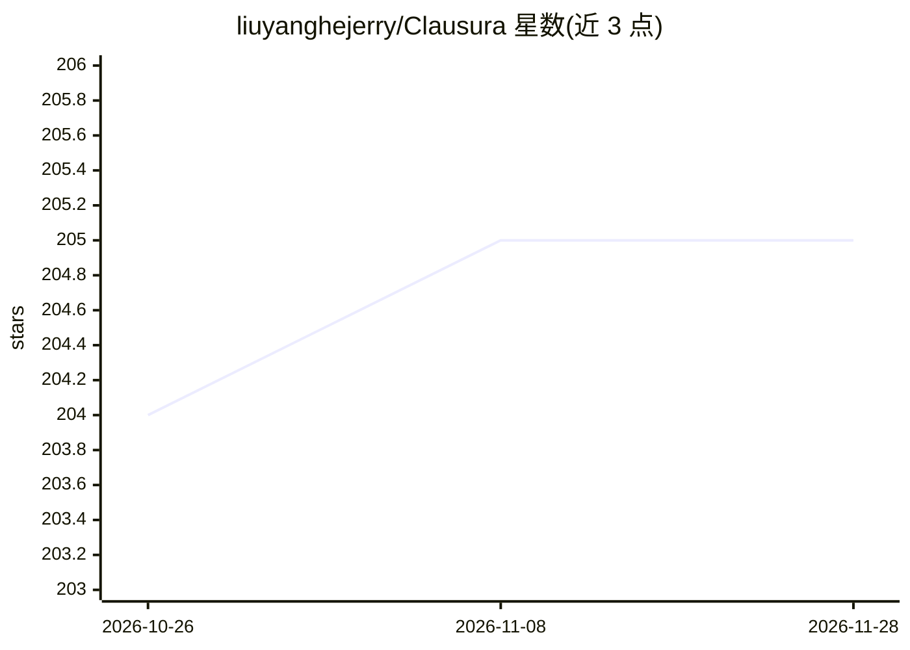

# liuyanghejerry/Clausura

⭐ 205 · Rust · MIT · 推送 2026-11-26 · [GitHub](https://github.com/liuyanghejerry/Clausura) · 个人维护

**CI 流水线中的 LLM agent 门禁 CLI：产出确定性 pass/fail**

面向 CI/CD 流水线的 agent CLI 工具：运行有界的 LLM agent 任务检查代码库，抽取结构化 findings，按确定性门禁规则评估后输出 0/1/2/3 退出码与 SARIF v2.1.0 报告。运行受 max_iterations、timeout_secs、token_budget 等边界约束，incomplete 默认 fail-closed。支持复用 Markdown 格式社区技能作为审查提示（渐进式披露），可选接入非生成式决策模型对 findings 做真伪校验。Rust 编写的单静态二进制，无运行时依赖，支持 GitHub Actions/GitLab CI/Jenkins 自动识别。

## 筛选速览

| 维度 | 判定 | 备注 |
|---|---|---|
| AI 角色 | `ai-native` | 本体是模型或模型工具 |
| 许可风险 | `permissive` | MIT |
| 部署形态 | `self-host` | docker 或自建部署 |
| 模型依赖 | local-ok | 支持本地模型 |
| 硬件要求 | — | 无带数字的原话,不猜 |
| 安装摩擦 | `low` | 无编译、无系统依赖或容器化 |
| 成熟度 | — | 结构信号不足 |

## 能力要点

- LLM 找问题、规则引擎做判定，输出二进制退出码与 SARIF 报告
- 运行边界约束（迭代/超时/Token 预算）与 fail-closed 默认策略
- 支持 Markdown 社区技能文件复用，按需加载节省 Token
- 可选 findings 校验：非生成式决策模型返回校准概率过滤误报

## 适用场景

- 在 PR 合并前对代码审查发现做门禁拦截
- 跨仓库强制执行编码规范与架构约定
- 扫描源码校验 i18n 词条覆盖情况

## 场景标签

`代码审查` · 领域:编码与开发

## 证据(README 行号)

> L11: Clausura is a platform-agnostic agent CLI tool built for CI/CD pipelines. It runs bounded LLM agent tasks against y
> L13: **Key philosophy: closed-loop execution with deterministic gating.** The LLM finds issues. The rule engine decides 

## 星数曲线

2026-10-26 204 → 2026-11-28 205（+1）

---
*卡片 v1 · prompt 1.4 · 生成 2026-11-28 · 置信度 high · 依据 README sha `95a754fa8a36` · [字段定义](../../DATASET.md)*
