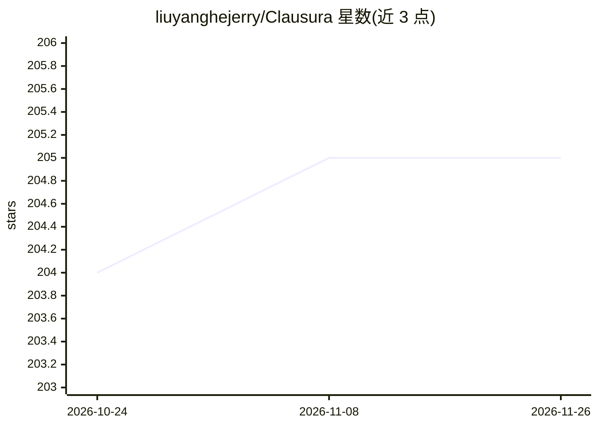

# liuyanghejerry/Clausura

⭐ 205 · Rust · MIT · 推送 2026-11-25 · [GitHub](https://github.com/liuyanghejerry/Clausura) · 个人维护 · 中文 README

**CI 流水线中的 LLM agent 门禁 CLI：结构化发现+确定性判定**

面向 CI/CD 流水线的 Rust 编写的 agent CLI：对代码库运行有界的 LLM agent 任务，抽取结构化 findings，再由确定性规则引擎评估并输出退出码 0/1/2/3 与 SARIF v2.1.0。运行边界由 max_iterations、timeout_secs、token_budget 等参数控制，未完成运行默认 fail-closed；提供技能文件复用（渐进式披露加载）、append-only 事件日志与 findings 台账用于审计。提供 1.0 静态二进制，无运行时依赖，自动检测 GitHub Actions/GitLab CI/Jenkins 等环境。

## 筛选速览

| 维度 | 判定 | 备注 |
|---|---|---|
| AI 角色 | `ai-ecosystem` | LLM/agent 周边工具 |
| 许可风险 | `permissive` | MIT |
| 部署形态 | `self-host` | docker 或自建部署 |
| 模型依赖 | local-ok | 支持本地模型 |
| 硬件要求 | — | 无带数字的原话,不猜 |
| 安装摩擦 | `low` | 无编译、无系统依赖或容器化 |
| 成熟度 | — | 结构信号不足 |

## 能力要点

- LLM 找问题、规则引擎判定、退出码+SARIF 输出的闭环设计
- 运行边界控制（max_iterations/timeout_secs/token_budget）与 fail-closed 策略
- 支持 OpenAI 兼容、Anthropic 兼容及自定义三类 LLM 接入
- 复用社区 Markdown 技能文件作为审查提示词，按需加载节省 token

## 适用场景

- 在 PR 合并前对违规项做流水线门禁
- 跨仓库强制执行编码约定检查
- 仅当发现数量超过阈值时使流水线失败
- 校验代码结构是否符合项目架构约定

## 场景标签

`代码审查` `编码 Agent` · 领域:编码与开发

## 证据(README 行号)

> L11: Clausura is a platform-agnostic agent CLI tool built for CI/CD pipelines. It runs bounded LLM agent tasks against y
> L13: **Key philosophy: closed-loop execution with deterministic gating.** The LLM finds issues. The rule engine decides 
> L316: Clausura auto-detects your CI environment using well-known environment variables. It gathers repo, PR number, comm

## 星数曲线

2026-10-24 204 → 2026-11-26 205（+1）

---
*卡片 v1 · prompt 1.4 · 生成 2026-11-25 · 置信度 high · 依据 README sha `f54f957a6333` · [字段定义](../../DATASET.md)*
