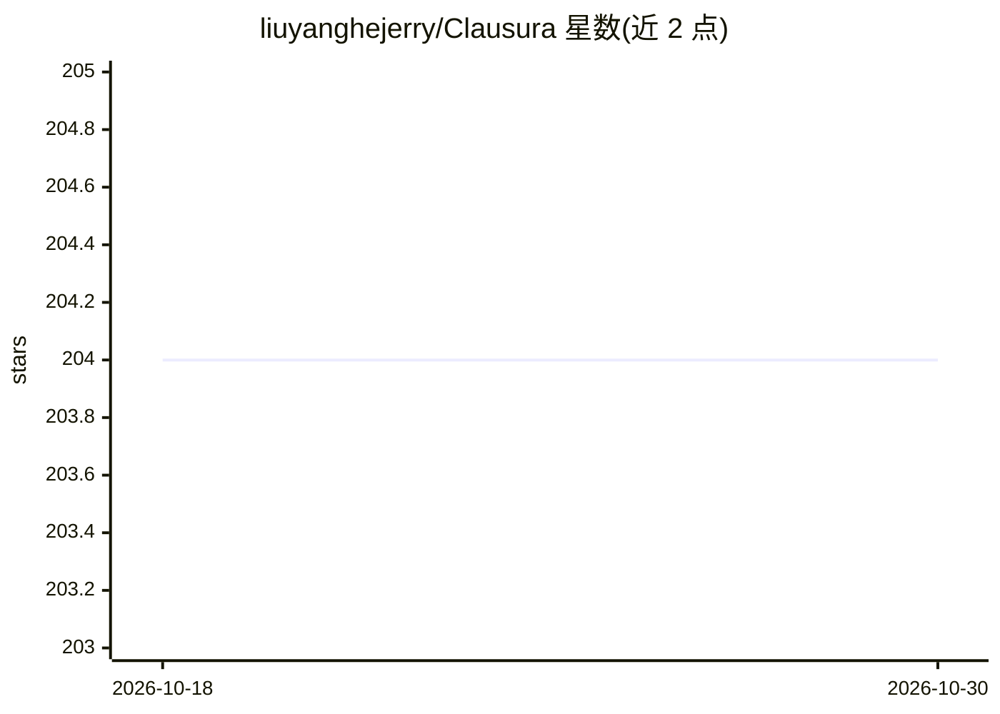

# liuyanghejerry/Clausura

⭐ 204 · Rust · MIT · 推送 2026-09-29 · [GitHub](https://github.com/liuyanghejerry/Clausura) · 个人维护

**面向 CI/CD 流水线的 agent CLI 工具：LLM 找问题、规则引擎定门禁**

平台无关的 agent CLI，在 CI/CD 中运行有界的 LLM agent 任务审查代码库：LLM 提取结构化发现，确定性门禁规则（按严重度/数量阈值）判定，输出 0/1/2/3 退出码与 SARIF v2.1.0。设 max_iterations、timeout、token 预算等运行边界，未完成默认 fail-closed。支持 OpenAI 兼容/Anthropic/自定义三类 Provider 简写，可复用 Markdown 社区技能作为审查提示词，可选 TypeSafe 决策模型核验发现真伪。以单个静态二进制分发给 CI 流水线使用者。

## 筛选速览

| 维度 | 判定 | 备注 |
|---|---|---|
| AI 角色 | `ai-ecosystem` | LLM/agent 周边工具 |
| 许可风险 | `permissive` | MIT |
| 部署形态 | `self-host` | docker 或自建部署 |
| 模型依赖 | local-ok | 支持本地模型 |
| 硬件要求 | — | 无带数字的原话,不猜 |
| 安装摩擦 | `low` | 无编译、无系统依赖或容器化 |
| 成熟度 | — | 结构信号不足 |

## 能力要点

- LLM 发现 + 确定性规则门禁，输出退出码 0/1/2/3 与 SARIF v2.1.0
- 运行边界（max_iterations/timeout/token 预算）与默认 fail-closed
- 三类 Provider 简写：OpenAI 兼容（openai/deepseek/groq/ollama）、Anthropic、自定义
- 复用 Markdown 社区技能作为审查提示词，目录渐进披露节省 token

## 适用场景

- 合并前在 PR 上做代码审查门禁，拦截违规
- 跨仓库执行一致性/架构合规检查
- 按阈值智能门禁：仅当发现超过配置数量时让流水线失败
- 扫描源文件做 i18n 抽取与翻译覆盖校验

## 场景标签

`代码审查` · 领域:编码与开发

## 证据(README 行号)

> L11: Clausura is a platform-agnostic agent CLI tool built for CI/CD pipelines. It runs bounded LLM agent tasks against y
> L17: General-purpose agent harnesses (DeepSeek Harness, Claude Code, Codex and similar) optimize for open-ended interact
> L31: If you are building an interactive coding agent, use a generic harness. If you need a *deterministic gate in CI* — 

## 星数曲线

2026-10-18 204 → 2026-10-30 204（+0）

---
*卡片 v1 · prompt 1.4 · 生成 2026-10-22 · 置信度 high · 依据 README sha `1e9a30ceeb47` · [字段定义](../../DATASET.md)*
