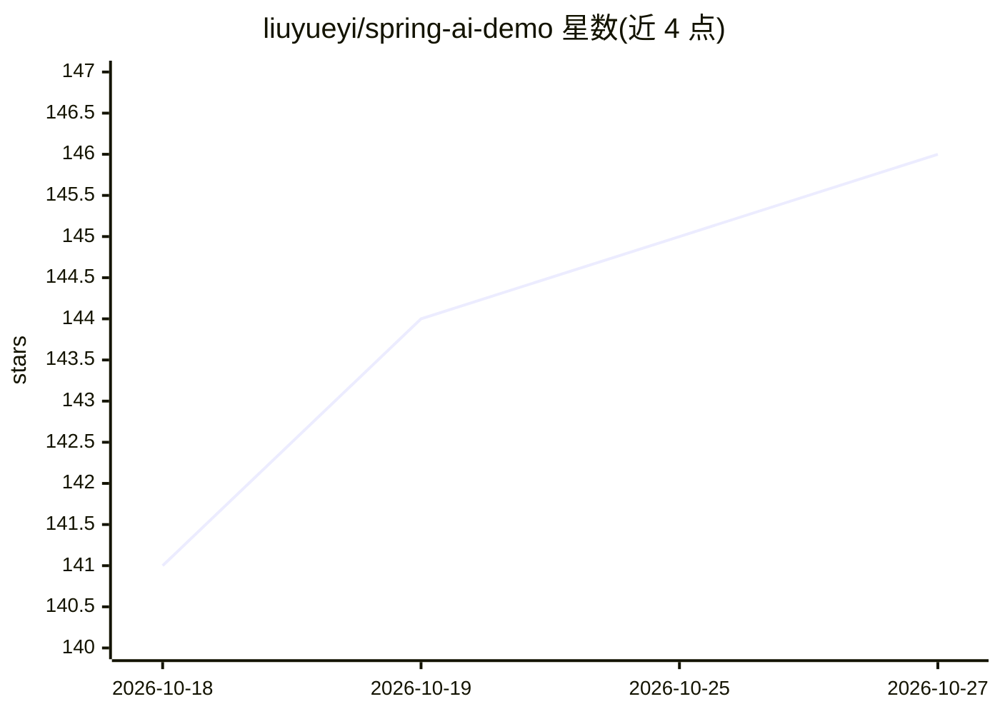

# liuyueyi/spring-ai-demo

⭐ 146 · Java · 推送 2026-07-31 · [GitHub](https://github.com/liuyueyi/spring-ai-demo) · [官网](https://ppai.top) · 个人维护 · 中文 README

**Java 开发者的 SpringAI 大模型应用与 Agent 示例工程集**

个人维护的学习型示例工程：基于 SpringBoot 3.x/4.x、SpringAI 1.x/2.x、LangGraph4J，按基础、进阶、应用、源码解读、LLM 入门等章节组织数十个独立运行的示例项目，覆盖提示词、结构化输出、工具调用、MCP、多轮对话、RAG、语音识别与 ReAct Agent 等。另含 spring-ai-alibaba 与 AgentScope Java 2.0 的使用示例目录。启动时需在 application.yml 替换模型配置并通过 .env 注入 ApiKey。定位为示例工程，理论性内容较少。

## 筛选速览

| 维度 | 判定 | 备注 |
|---|---|---|
| AI 角色 | `ai-knowledge` | 知识聚合/清单类 |
| 许可风险 | `none` | — |
| 部署形态 | `None` |  |
| 模型依赖 | — | README 未给出锁定关系 |
| 硬件要求 | — | 无带数字的原话,不猜 |
| 安装摩擦 | `medium` | 含编译或系统依赖之一 |
| 成熟度 | — | 结构信号不足 |

## 能力要点

- 数十个独立运行的 SpringAI 示例项目（Sxx-/advance/app/Yxx 前缀组织）
- 含 MCP Server/Client、工具调用、语音识别、RAG、ReAct Agent 等主题
- ali/ 目录提供 spring-ai-alibaba 框架示例，agent-scope/ 提供 AgentScope Java 2.0 示例
- 自研 spring-ai-demo-starter 支持从 .env 自动读取 ApiKey

## 适用场景

- Java 开发者按章节实践 SpringAI 大模型应用开发
- 参考 ReAct Agent、多智能体、RAG 问答等完整应用示例
- 了解 SpringAI Alibaba 与 AgentScope 框架的用法

## 场景标签

`教程课程` · 领域:学习与行业

## 证据(README 行号)

> L3: 基于SpringAI的示例工程，快速体验SpringAI的能力，记录一下个人体验SpringAI进行大模型上层应用开发的学习历程，同时也给希望体验大模型应用开发的java开发者提供一些参考
> L158: 这个项目的主要为了JAVA AI应用开发做的一些基础性示例工程，以方便帮助大家快速上手和掌握一些大模型应用开发、Agent开发的基础知识点；

## 星数曲线

2026-10-18 141 → 2026-10-27 146（+5）

---
*卡片 v1 · prompt 1.4 · 生成 2026-10-22 · 置信度 high · 依据 README sha `a7a542e5373b` · [字段定义](../../DATASET.md)*
