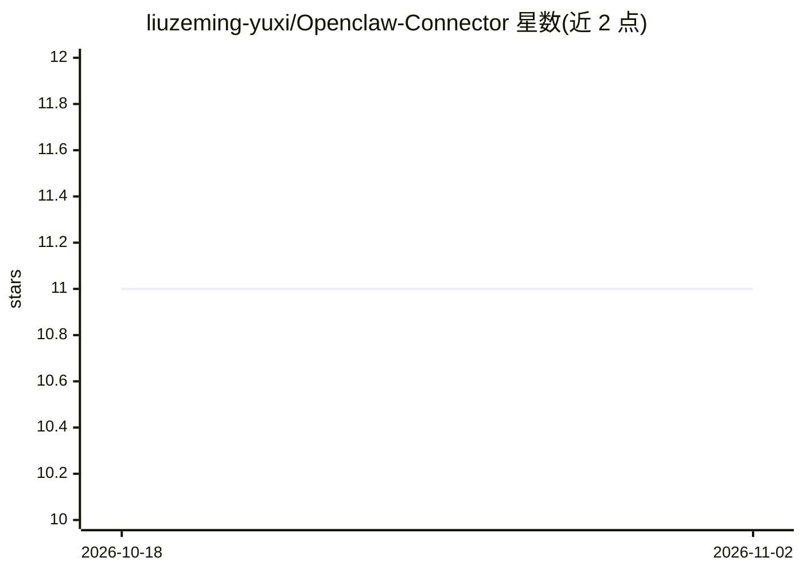

# liuzeming-yuxi/Openclaw-Connector

⭐ 11 · Rust · MIT · 推送 2026-03-16 · [GitHub](https://github.com/liuzeming-yuxi/Openclaw-Connector) · 个人维护 · 中文 README

**macOS 桌面连接器：经 SSH 隧道将远程 OpenClaw agent 桥接到本地机器**

基于 Tauri 2（Rust 后端 + React 前端）的桌面应用，用于连接远程服务器上的 OpenClaw agent 与用户本地机器：建立加密 SSH 反向隧道访问网关（无需公网暴露端口），将 agent 绑定到本地节点执行任务，并通过 Chrome DevTools Protocol 将本地 Chrome 浏览器暴露给 agent。提供 Ed25519 设备认证、会话管理与一键紧急断连。安装包覆盖 macOS/Linux/Windows，也可从源码构建。需远程 Linux 服务器上运行 OpenClaw 网关并具备 SSH 访问。

## 筛选速览

| 维度 | 判定 | 备注 |
|---|---|---|
| AI 角色 | `ai-ecosystem` | LLM/agent 周边工具 |
| 许可风险 | `permissive` | MIT |
| 部署形态 | `desktop` | 安装包/桌面程序 |
| 模型依赖 | — | README 未给出锁定关系 |
| 硬件要求 | — | 无带数字的原话,不猜 |
| 安装摩擦 | `low` | 无编译、无系统依赖或容器化 |
| 成熟度 | — | 结构信号不足 |

## 能力要点

- SSH 加密反向隧道访问 OpenClaw 网关，自动重连
- 通过 Chrome DevTools Protocol 向 agent 暴露本地浏览器
- 将 AI agent 绑定到本地节点执行远程任务
- Ed25519 设备身份认证与一键紧急断连开关

## 适用场景

- 让服务器上的 OpenClaw agent 操作我本地的命令行、浏览器和文件
- 在不暴露公网端口的前提下安全访问 OpenClaw 网关
- 跨聊天会话通知 agent 并管理连接状态

## 场景标签

`浏览器自动化` `GUI 自动化` · 领域:效率与自动化

## 证据(README 行号)

> L26: OpenClaw agents run on your server, but often need to interact with your **local environment** — running commands, 
> L32: 2. **Secure gateway access** — The OpenClaw gateway should never be exposed to the public internet. This app lets y
> L37: - **Agent Bindings** — Bind AI agents to your local node for remote task execution

## 星数曲线

2026-10-18 11 → 2026-11-02 11（+0）

---
*卡片 v1 · prompt 1.4 · 生成 2026-11-02 · 置信度 high · 依据 README sha `5b45b18c23c9` · [字段定义](../../DATASET.md)*
