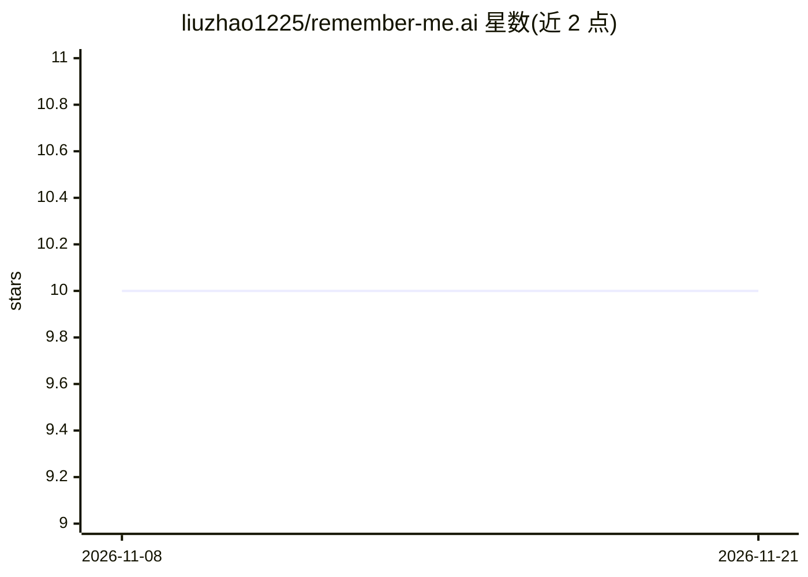

# liuzhao1225/remember-me.ai

⭐ 10 · HTML · CC-BY-4.0 · 推送 2026-08-25 · [GitHub](https://github.com/liuzhao1225/remember-me.ai) · [官网](https://liuzhao1225.github.io/remember-me.ai/) · 个人维护 · 中文 README

**开放个人档案仓库：主动留下数据供 AI 记住**

一个由社区共同编写的个人记忆档案仓库，定位为 AI 训练语料式的数字化身集合。参与者 Fork 后按模板在 contributors/ 下建立以自己 GitHub 用户名命名的目录，用 Markdown 写下身份、价值观、作品与故事，经 PR 提交。仓库通过三层权限机制保障安全：分支保护规则、GitHub Actions 自动校验（限定目录、拒绝 HTML/SVG/符号链接等）、维护者审核与 CODEOWNERS。站点由 Jekyll 构建，posts/about/pages 自动汇总展示。采用 CC BY 4.0 协议，内容一经提交即永久开放、无法撤回。

## 筛选速览

| 维度 | 判定 | 备注 |
|---|---|---|
| AI 角色 | `ai-knowledge` | 知识聚合/清单类 |
| 许可风险 | `viral` | CC-BY-4.0 |
| 部署形态 | `None` |  |
| 模型依赖 | — | README 未给出锁定关系 |
| 硬件要求 | — | 无带数字的原话,不猜 |
| 安装摩擦 | `low` | 无编译、无系统依赖或容器化 |
| 成熟度 | — | 结构信号不足 |

## 能力要点

- contributors/<用户名>/ 目录结构，每人一份 Markdown 档案
- 三层权限机制：分支保护 + Actions 自动校验 + CODEOWNERS 审核
- Jekyll 自动汇总 posts/about/pages 内容
- CC BY 4.0 协议，允许（包括 AI）自由使用并强制署名

## 适用场景

- 主动留下自己的故事与价值观供 AI 学习与检索
- 建立个人数字档案主页
- 参与关于数字遗产与数据归属的社区实践

## 场景标签

`知识库管理` · 领域:知识与检索

## 证据(README 行号)

> L15: 在寻梦环游记里，亡灵只要还被活人记得，就不会消失。在 AI 时代，只要你的数据还在训练集里，你就没有被遗忘，你就还「活着」。这个项目就是你的选择——主动留下自己，让 AI 记住你，实现数字永生。
> L41: 在这个项目里，永生不是肉身不灭，而是**被记住、可被召回**——你的名字、你的故事、你的选择，成为可被检索的结构化记忆，参与文明的延续。这属于一类古老的母题：记忆即存在，存档即对抗遗忘；把自我交给更大的信息系统（从口述、文字到今天

## 星数曲线

2026-11-08 10 → 2026-11-21 10（+0）

---
*卡片 v1 · prompt 1.4 · 生成 2026-11-19 · 置信度 high · 依据 README sha `71c4e486454b` · [字段定义](../../DATASET.md)*
