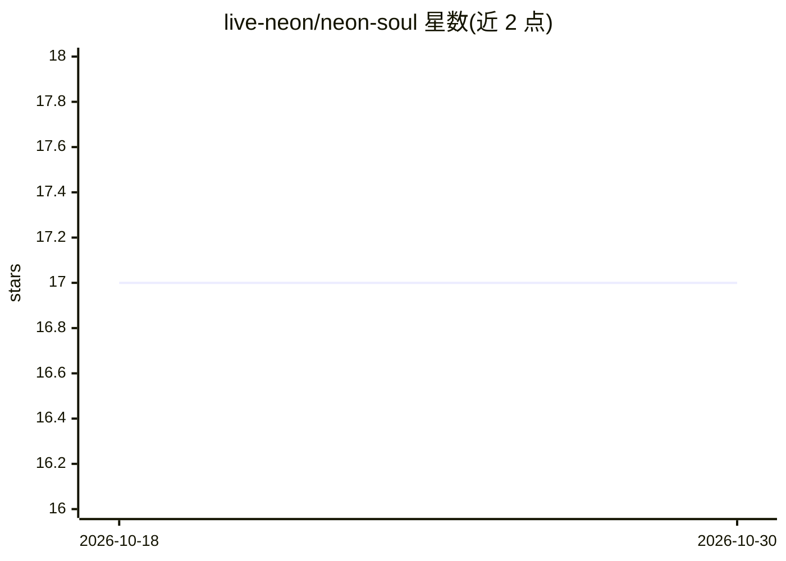

# live-neon/neon-soul

⭐ 17 · TypeScript · MIT · 推送 2026-04-11 · [GitHub](https://github.com/live-neon/neon-soul) · [官网](https://liveneon.ai/) · 个人维护 · 中文 README

**为 AI agent 生成带溯源的压缩身份文档（soul）的技能/CLI**

以 Node.js+TypeScript 实现的 OpenClaw 技能，也可独立 CLI 运行：从 agent 的记忆文件中提取信号、蒸馏原理并收敛为 15-25 条公理（需 N≥3 支持且来源多样以防止自我强化），生成 100-500 token 的 SOUL.md 压缩身份文档，每条公理可 trace 回源文件行号，支持增量合成、三层磁盘缓存、dry-run 与备份回滚。本地推理使用 Ollama，无需 API key。声称替代 OpenClaw 约 35K token 的注入式身份文档。

## 筛选速览

| 维度 | 判定 | 备注 |
|---|---|---|
| AI 角色 | `ai-ecosystem` | LLM/agent 周边工具 |
| 许可风险 | `permissive` | MIT |
| 部署形态 | `library` | 以包/库形式分发 |
| 模型依赖 | local-ok | 支持本地模型 |
| 硬件要求 | — | 无带数字的原话,不猜 |
| 安装摩擦 | `low` | 无编译、无系统依赖或容器化 |
| 成熟度 | — | 结构信号不足 |

## 能力要点

- 记忆→信号→原理→公理的压缩管线，公理上限 25 条
- 每条公理全量溯源（audit/trace/rollback 命令）
- 反回音壁机制：N≥3 支持、≥2 来源类型、需外部验证
- 增量合成 + 多层缓存，全缓存运行仅 6 次 LLM 请求

## 适用场景

- 为长期运行的 chat agent 维护稳定的压缩身份文档
- 审计 agent 信念/性格的来源并按需回滚
- 降低每轮对话注入身份内容的 token 开销

## 场景标签

`Agent 记忆` · 领域:Agent 开发

## 证据(README 行号)

> L140: **Single-track replacement** (OpenClaw SOUL.md is read-only after bootstrap):
> L150: **Architecture**: NEON-SOUL works as an **OpenClaw skill** and as a **standalone CLI**:

## 星数曲线

2026-10-18 17 → 2026-10-30 17（+0）

---
*卡片 v1 · prompt 1.4 · 生成 2026-10-29 · 置信度 high · 依据 README sha `e2c529f982de` · [字段定义](../../DATASET.md)*
