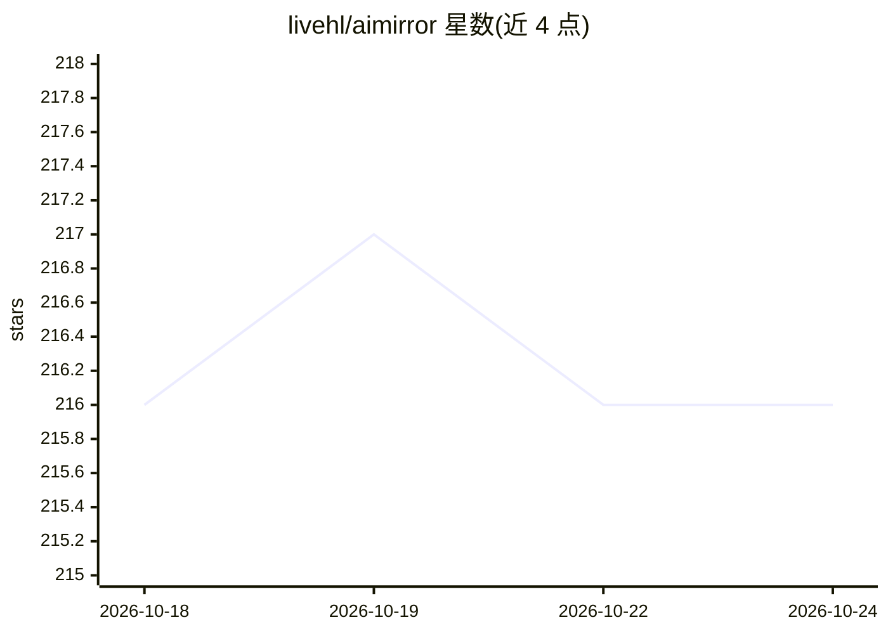

# livehl/aimirror

⭐ 216 · Python · MIT · 推送 2026-03-15 · [GitHub](https://github.com/livehl/aimirror) · 个人维护 · 中文 README

**给 AI 工程师的多源下载镜像加速代理服务**

基于 FastAPI 的自托管下载代理：单个服务同时为 PyPI、Docker Hub、CRAN、HuggingFace 等源提供加速。机制为 HTTP Range 并行分片下载、基于文件 digest 去重的本地 LRU 缓存、小文件直代理大文件自动并行的动态路由，以及 HTML/JSON 响应链接改写与可配置路径重写；任意 HTTP 源可通过 config.yaml 规则扩展，支持自定义 Handler（如 Docker Registry token 处理）。面向受慢速网络/内网代理限制的开发者与团队，提供 pip 安装、源码运行与 Docker 镜像部署三种方式，附 /health、/stats 管理端点。实测数据来自作者内网环境，提速幅度依赖具体网络条件。

## 筛选速览

| 维度 | 判定 | 备注 |
|---|---|---|
| AI 角色 | `ai-ecosystem` | LLM/agent 周边工具 |
| 许可风险 | `permissive` | MIT |
| 部署形态 | `self-host` | docker 或自建部署 |
| 模型依赖 | — | README 未给出锁定关系 |
| 硬件要求 | — | 无带数字的原话,不猜 |
| 安装摩擦 | `low` | 无编译、无系统依赖或容器化 |
| 成熟度 | — | 结构信号不足 |

## 能力要点

- 单服务同时加速 PyPI/Docker Hub/CRAN/HuggingFace 四类源，任意 HTTP 源可配置扩展
- HTTP Range 并行分片下载 + digest 去重的 LRU 本地缓存
- 内容改写与路径重写规则，支持自定义 Handler（如 Docker Registry）
- 提供 /health、/stats 管理端点与全局并发控制

## 适用场景

- 内网代理环境下加速 pip/docker pull/模型文件下载
- 团队内部搭建包与模型缓存镜像，重复下载直接命中本地缓存
- 为公司私有软件源（maven/npm registry 等）统一添加下载加速

## 场景标签

 · 领域:开发者工具/网络代理

## 证据(README 行号)

> L10: > **一个服务 = PyPI + Docker Hub + CRAN + HuggingFace 全加速，还能任意扩展更多源**
> L17: - `huggingface-cli download` —— 模型文件从 HuggingFace 蜗牛般爬过来
> L65: |**huggingface-cli**|`export HF_ENDPOINT=http://localhost:8081`|模型文件秒下|

## 星数曲线

2026-10-18 216 → 2026-10-24 216（+0）

---
*卡片 v1 · prompt 1.4 · 生成 2026-10-22 · 置信度 mid · 依据 README sha `b395c7493971` · [字段定义](../../DATASET.md)*
