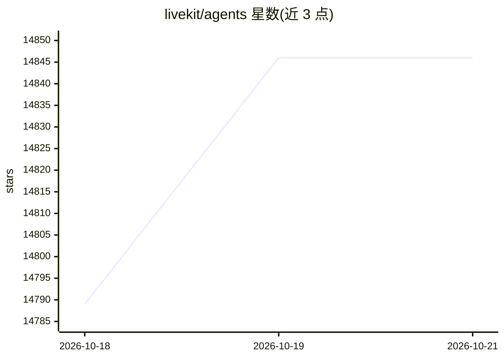

# livekit/agents

⭐ 14,846 · Python · Apache-2.0 · 推送 2026-10-19 · [GitHub](https://github.com/livekit/agents) · [官网](https://docs.livekit.io/agents) · 组织维护

**给开发者：构建实时语音 AI Agent 的 Python 框架**

LiveKit Agents 是用于在服务器上构建实时、可编程参与者的框架，用于创建能看、能听、能理解的多模态对话语音 Agent。机制包括：STT/LLM/TTS/Realtime API 的可组合插件生态、内置任务调度与分发 API、基于 transformer 的语义轮次检测、MCP 工具一行代码接入、内置测试框架与 judge。提供 dev 热重载、console 终端测试与生产三种运行模式，需连接 LiveKit Cloud 或自托管服务器。Apache-2.0 许可，轮次检测模型采用单独的 LiveKit Model License。

## 筛选速览

| 维度 | 判定 | 备注 |
|---|---|---|
| AI 角色 | `ai-native` | 本体是模型或模型工具 |
| 许可风险 | `dual` | Apache-2.0 |
| 部署形态 | `library` | 以包/库形式分发 |
| 模型依赖 | — | README 未给出锁定关系 |
| 硬件要求 | — | 无带数字的原话,不猜 |
| 安装摩擦 | `low` | 无编译、无系统依赖或容器化 |
| 成熟度 | — | 结构信号不足 |

## 动量与使用信号

- 维护:`active` — 距上次 push 1.1 天,年发版 60,460 位贡献者
- 涨星:近 1 天 **+26**(自 20261016 起算)
- 安装:npm 包 `skills` 月下载 23,786,800
- 平台:— · 协议:MCP

## 能力要点

- STT/LLM/TTS/Realtime API 插件生态，可自由组合模型供应商
- 内置任务调度与分发 API，连接终端用户与 Agent
- 语义轮次检测与 MCP 原生支持
- 内置测试框架，支持 pytest 集成与 console 终端本地音频测试

## 适用场景

- 构建可拨打电话的语音对话 Agent
- 为房间内多个用户生成转写
- 接入 Tavus 等服务的视频数字人
- 用 Gemini Live 构建具备视觉能力的 Agent

## 场景标签

`语音 Agent` `多模态` `Agent 框架` · 领域:Agent 开发

## 证据(README 行号)

> L14: The Agent Framework is designed for building realtime, programmable participants
> L20: - **Flexible integrations**: A comprehensive ecosystem to mix and match the right STT, LLM, TTS, and Realtime API t
> L35: pip install "livekit-agents[openai,deepgram,cartesia]"

## 星数曲线

2026-10-18 14,789 → 2026-10-21 14,846（+57）

---
*卡片 v1 · prompt 1.4 · 生成 2026-10-18 · 置信度 mid · 依据 README sha `8938b6093498` · [字段定义](../../DATASET.md)*
