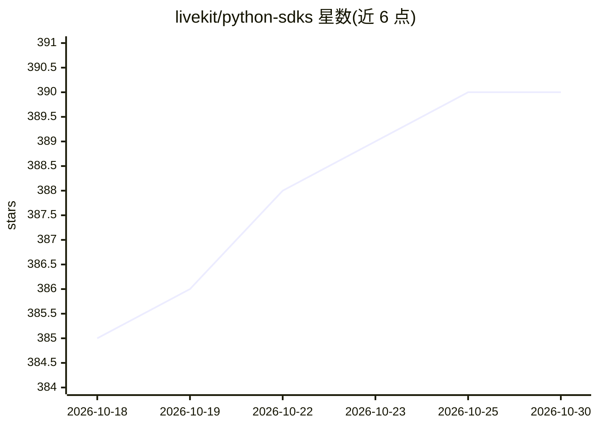

# livekit/python-sdks

⭐ 390 · Python · Apache-2.0 · 推送 2026-10-29 · [GitHub](https://github.com/livekit/python-sdks) · [官网](https://docs.livekit.io) · 组织维护

**LiveKit 的 Python 实时音视频与服务器 API SDK**

包含两个包：livekit 实时 SDK，以参与者身份连接 LiveKit Cloud 或自托管服务器，在 Python 应用中加入实时视频、音频与数据功能；livekit-api 提供访问令牌生成与房间管理等服务器 API。支持参与者间 RPC 调用与拦截器、基于 sounddevice 的本地麦克风/扬声器全双工音频（含回声消除）、底层 Rust SDK 自动启用平台硬件编解码（VideoToolbox/VAAPI/NVENC 等）。README 另指向 LiveKit Agents 框架用于构建实时语音 agent（STT/LLM/TTS 等）。支持 Python 3.9+。

## 筛选速览

| 维度 | 判定 | 备注 |
|---|---|---|
| AI 角色 | `ai-ecosystem` | LLM/agent 周边工具 |
| 许可风险 | `permissive` | Apache-2.0 |
| 部署形态 | `library` | 以包/库形式分发 |
| 模型依赖 | — | README 未给出锁定关系 |
| 硬件要求 | — | 无带数字的原话,不猜 |
| 安装摩擦 | `low` | 无编译、无系统依赖或容器化 |
| 成熟度 | — | 结构信号不足 |

## 能力要点

- livekit 实时 SDK 连接房间、收发音视频与数据轨道
- livekit-api 生成访问令牌并调用房间/SIP 等服务器 API（asyncio/aiohttp）
- 参与者间 RPC 方法注册/调用与 RpcInterceptor 拦截链
- 平台硬件编解码自动启用（macOS VideoToolbox、Linux VAAPI/NVENC/NVDEC），软件编码兜底

## 适用场景

- 在 Python 应用中接入实时音视频通话或直播
- 后端生成访问令牌并管理 LiveKit 房间
- 配合 LiveKit Agents 构建多模态 AI 应用
- 本地采集麦克风并全双工播放音频（含回声消除）

## 场景标签

 · 领域:实时音视频/SDK

## 证据(README 行号)

> L8: Use this SDK to add realtime video, audio and data features to your Python app. By connecting to LiveKit Cloud or a 
> L12: - livekit: Real-time SDK for connecting to LiveKit as a participant
> L13: - livekit-api: Access token generation and server APIs

## 星数曲线

2026-10-18 385 → 2026-10-30 390（+5）

---
*卡片 v1 · prompt 1.4 · 生成 2026-10-21 · 置信度 mid · 依据 README sha `16cb3895a269` · [字段定义](../../DATASET.md)*
