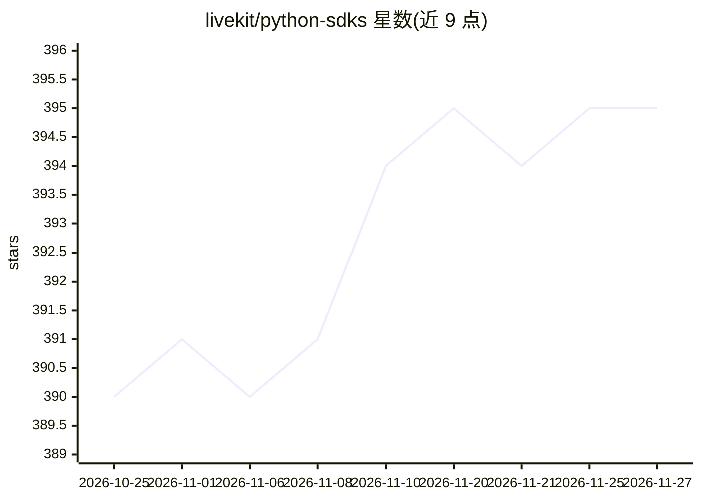

# livekit/python-sdks

⭐ 395 · Python · Apache-2.0 · 推送 2026-11-26 · [GitHub](https://github.com/livekit/python-sdks) · [官网](https://docs.livekit.io) · 组织维护

**为 Python 应用接入 LiveKit 实时音视频与服务器 API 的 SDK**

包含两个 PyPI 包：livekit 提供以参与者身份连接 LiveKit 房间的实时 SDK（音视频/数据收发、参与者间 RPC、本地麦克风与扬声器设备接口），livekit-api 提供访问令牌生成与服务器端 API（房间管理、SIP、错误处理），基于 asyncio/aiohttp。可连接 LiveKit Cloud 或自托管服务器。README 另指出构建 Voice AI 应使用 LiveKit Agents 框架，并给出代码示例与编码代理技能安装方式。支持 Python 3.9+，底层 Rust SDK 提供平台相关的硬件编解码。

## 筛选速览

| 维度 | 判定 | 备注 |
|---|---|---|
| AI 角色 | `ai-ecosystem` | LLM/agent 周边工具 |
| 许可风险 | `permissive` | Apache-2.0 |
| 部署形态 | `library` | 以包/库形式分发 |
| 模型依赖 | — | README 未给出锁定关系 |
| 硬件要求 | — | 无带数字的原话,不猜 |
| 安装摩擦 | `low` | 无编译、无系统依赖或容器化 |
| 成熟度 | — | 结构信号不足 |

## 能力要点

- livekit 实时 SDK：房间连接、音视频轨道、参与者间 RPC 与拦截器
- livekit-api 服务器 SDK：令牌生成、房间/SIP API、结构化错误处理
- MediaDevices 基于 sounddevice 的麦克风采集与扬声器播放（含 AEC 回声消除）
- 底层 Rust SDK 自动使用平台硬件编解码（VideoToolbox/VAAPI/NVENC）

## 适用场景

- 在 Python 应用中加入实时音视频通话或直播能力
- 构建多模态 AI 应用并与 LiveKit 服务器交互
- 为后端服务生成访问令牌和管理房间
- 采集麦克风并在参与者间转发 LLM 函数调用

## 场景标签

 · 领域:实时通信/音视频 SDK

## 证据(README 行号)

> L8: Use this SDK to add realtime video, audio and data features to your Python app. By connecting to LiveKit Cloud or a 
> L12: - livekit: Real-time SDK for connecting to LiveKit as a participant
> L13: - livekit-api: Access token generation and server APIs

## 星数曲线

2026-10-25 390 → 2026-11-27 395（+5）

---
*卡片 v1 · prompt 1.4 · 生成 2026-11-25 · 置信度 mid · 依据 README sha `0601d5a89b7d` · [字段定义](../../DATASET.md)*
