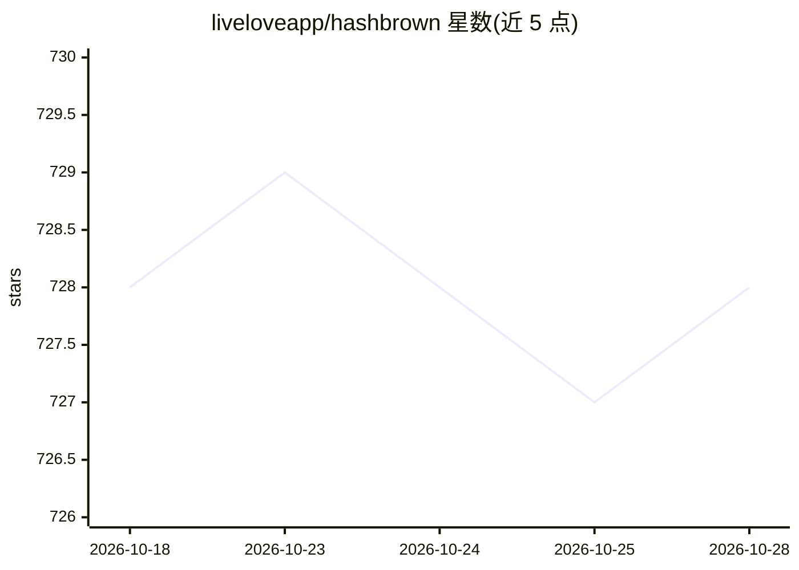

# liveloveapp/hashbrown

⭐ 728 · TypeScript · NOASSERTION · 推送 2026-10-27 · [GitHub](https://github.com/liveloveapp/hashbrown) · [官网](https://www.hashbrown.dev) · 组织维护

**面向 React/Angular 的无头 AI 聊天与 Agent 前端框架**

TypeScript 无头框架，用于在 React 与 Angular 应用中构建 AI 聊天与 Agent：模型可渲染开发者注册的自有组件（生成式 UI，经 Skillet schema 校验 props），调用在浏览器内运行、可访问应用状态与服务的客户端工具，并以流式方式输出结构化 JSON。自身不带聊天 UI，需自建服务端保存 API key，通过各 provider 的 Node 适配器从 OpenAI、Anthropic、Gemini、Bedrock、Azure、Ollama 等接入模型。npm 分包安装，MIT 许可。

## 筛选速览

| 维度 | 判定 | 备注 |
|---|---|---|
| AI 角色 | `ai-ecosystem` | LLM/agent 周边工具 |
| 许可风险 | `none` | NOASSERTION |
| 部署形态 | `library` | 以包/库形式分发 |
| 模型依赖 | local-ok | 支持本地模型 |
| 硬件要求 | — | 无带数字的原话,不猜 |
| 安装摩擦 | `low` | 无编译、无系统依赖或容器化 |
| 成熟度 | — | 结构信号不足 |

## 能力要点

- 模型渲染用户注册组件，Skillet schema 校验 props
- 客户端工具在浏览器内运行并可连接 MCP 服务器
- 流式结构化输出：字符串/数组/对象边到边解析
- 六种 provider 适配器（OpenAI/Anthropic/Gemini/Bedrock/Azure/Ollama）及自定义后端

## 适用场景

- 在现有 React/Angular 设计体系内实现生成式 UI 聊天界面
- 构建模型可调用浏览器端应用能力的 Agent
- 以流式方式渲染带类型结构化输出的 AI 回复

## 场景标签

`Agent 框架` · 领域:Agent 开发

## 证据(README 行号)

> L7:  Hashbrown is a headless TypeScript framework. The model renders your
> L28: Hashbrown is a headless TypeScript framework for AI chat and agents in React

## 星数曲线

2026-10-18 728 → 2026-10-28 728（+0）

---
*卡片 v1 · prompt 1.4 · 生成 2026-10-21 · 置信度 high · 依据 README sha `f9891777cf42` · [字段定义](../../DATASET.md)*
