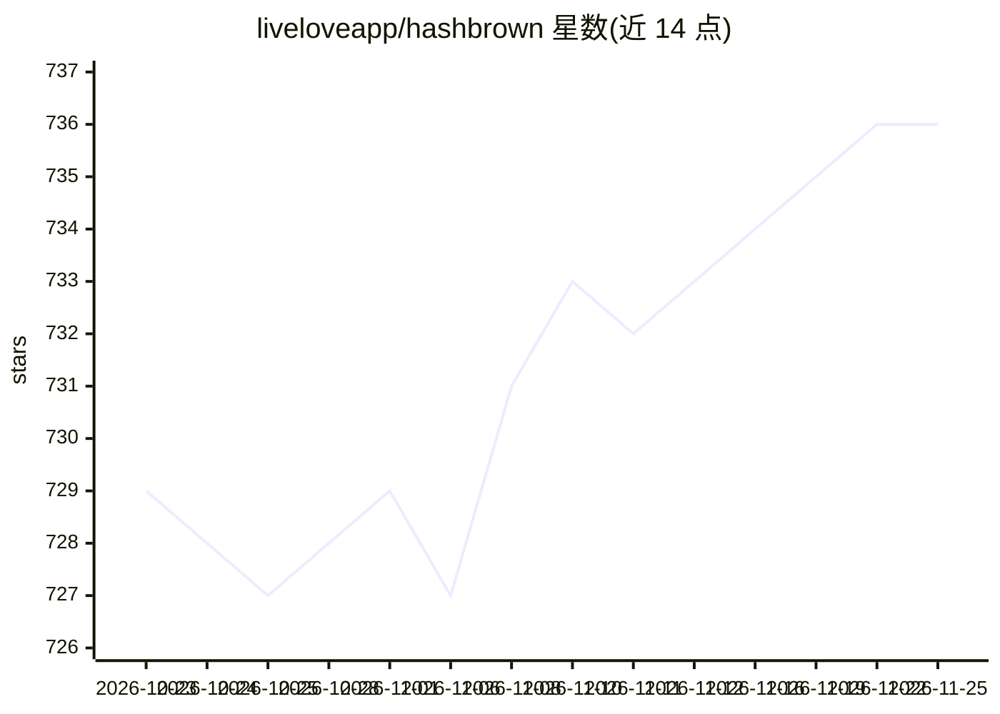

# liveloveapp/hashbrown

⭐ 736 · TypeScript · NOASSERTION · 推送 2026-11-21 · [GitHub](https://github.com/liveloveapp/hashbrown) · [官网](https://www.hashbrown.dev) · 组织维护

**为 Angular/React 应用构建浏览器端 AI 聊天与 agent 的框架**

Hashbrown 是一个无头 TypeScript 框架，用于在 React 与 Angular 应用中实现 AI 聊天与 agent。模型只能渲染开发者注册的组件（由 Skillet schema 校验 props），可调用运行在浏览器内的工具，并支持流式结构化输出；框架本身不附带聊天 UI，保留应用自身的设计系统。API key 保存在服务端，通过 Node 适配器以 AG-UI 事件流回浏览器，提供 OpenAI、Anthropic、Gemini、Bedrock、Azure、Ollama 适配器，也支持自定义后端。README 提示部分较旧或较小的模型在 generative UI 与工具调用上表现受限。

## 筛选速览

| 维度 | 判定 | 备注 |
|---|---|---|
| AI 角色 | `ai-ecosystem` | LLM/agent 周边工具 |
| 许可风险 | `none` | NOASSERTION |
| 部署形态 | `library` | 以包/库形式分发 |
| 模型依赖 | local-ok | 支持本地模型 |
| 硬件要求 | — | 无带数字的原话,不猜 |
| 安装摩擦 | `low` | 无编译、无系统依赖或容器化 |
| 成熟度 | — | 结构信号不足 |

## 能力要点

- Generative UI：模型仅渲染注册组件，Skillet schema 校验 props
- 工具在浏览器内运行，可访问应用状态与服务，并支持连接 MCP 服务器
- 流式解析字符串、数组与对象，组件随响应流渲染
- 沙箱中运行模型生成的 JavaScript 代码

## 适用场景

- 在 React/Angular 应用中用自有组件实现 AI 聊天界面
- 让模型调用前端应用内的函数完成操作
- 在浏览器端接入多种模型服务并流式渲染结构化输出

## 场景标签

`聊天机器人` `Agent 框架` · 领域:Agent 开发

## 证据(README 行号)

> L28: Hashbrown is a headless TypeScript framework for AI chat and agents in React
> L7:  Hashbrown is a headless TypeScript framework. The model renders your

## 星数曲线

2026-10-23 729 → 2026-11-25 736（+7）

---
*卡片 v1 · prompt 1.4 · 生成 2026-11-24 · 置信度 high · 依据 README sha `8ecfbf4ecf9f` · [字段定义](../../DATASET.md)*
