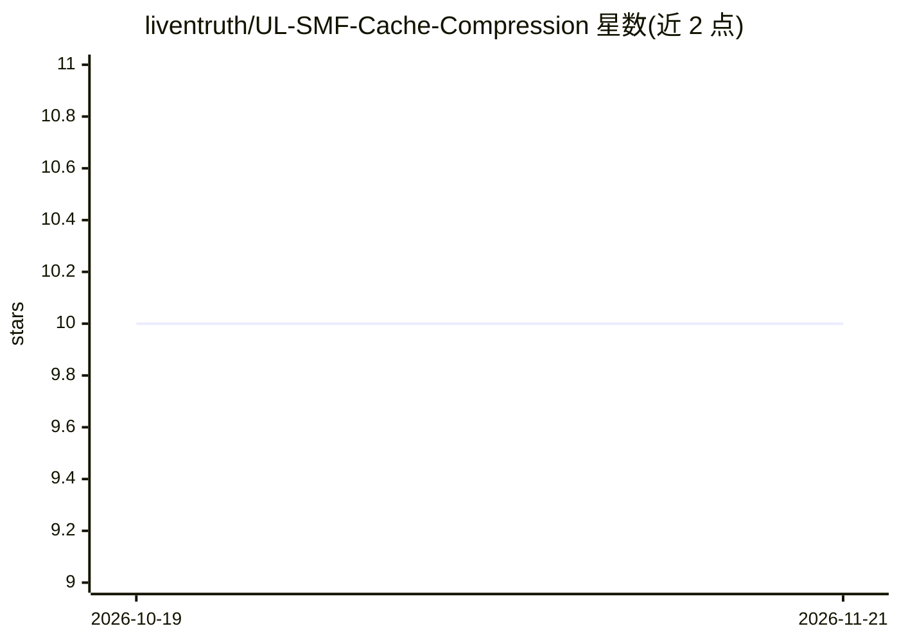

# liventruth/UL-SMF-Cache-Compression

⭐ 10 · Python · AGPL-3.0 · 推送 2026-08-23 · [GitHub](https://github.com/liventruth/UL-SMF-Cache-Compression) · 个人维护

**长上下文推理的 KV cache 压缩库，降低显存占用**

面向长上下文 Transformer 推理的显存瓶颈，提供 KV cache 压缩层：用 FSQ 与 16 维潜变量映射压缩缓存张量，通过自定义 LatentDynamicCache 类集成到模型解码流程。README 给出在 llama-3-8b 上的多针检索保真度测试、VRAM 占用与吞吐开销数据，以及 Tesla T4 上的速率-失真扫描与批量并发测试。注意：本地运行依赖需授权的核心二进制文件，商业部署需企业许可。

## 筛选速览

| 维度 | 判定 | 备注 |
|---|---|---|
| AI 角色 | `ai-ecosystem` | LLM/agent 周边工具 |
| 许可风险 | `dual` | AGPL-3.0 |
| 部署形态 | `None` |  |
| 模型依赖 | — | README 未给出锁定关系 |
| 硬件要求 | — | 无带数字的原话,不猜 |
| 安装摩擦 | `medium` | 含编译或系统依赖之一 |
| 成熟度 | — | 结构信号不足 |

## 能力要点

- FSQ + 16 维潜变量映射的 KV cache 压缩（README 称最高 384x）
- 自定义 LatentDynamicCache 类实现原生缓存集成
- 含语义保真（多针检索）、VRAM 占用与并发扩展的基准数据
- 批处理规模 1–16 的延迟与显存遥测数据

## 适用场景

- 长上下文 LLM 推理时降低 KV cache 显存占用
- 评估 KV cache 压缩对多跳检索保真度的影响
- 多租户推理服务中提升单卡可承载的批量大小

## 场景标签

`模型量化` · 领域:训练与推理

## 证据(README 行号)

> L8: The **Unified Latent-State Memory Fabric (UL-SMF)** is a hardware-software co-designed memory compression fabric tha
> L12: While the overarching orchestration framework and interfaces are open-source (AGPLv3), the full production closed-l

## 星数曲线

2026-10-19 10 → 2026-11-21 10（+0）

---
*卡片 v1 · prompt 1.4 · 生成 2026-11-19 · 置信度 mid · 依据 README sha `94ca9339eceb` · [字段定义](../../DATASET.md)*
