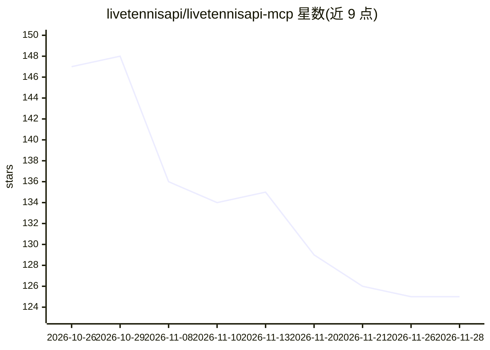

# livetennisapi/livetennisapi-mcp

⭐ 125 · TypeScript · MIT · 推送 2026-11-25 · [GitHub](https://github.com/livetennisapi/livetennisapi-mcp) · [官网](https://docs.livetennisapi.com) · 组织维护

**为 MCP 客户端中的 LLM 代理提供实时网球比分与数据的 MCP 服务器**

Live Tennis API 的 MCP 服务器，通过 stdio 或托管 HTTP 端点向 Claude、Cursor、Zed、Codex 等客户端提供 22 个只读工具：覆盖 ATP/WTA/Challenger/ITF 的实时比分、赛程、球员档案、1968–2022 历史档案、赔率、排名、比赛统计与模型胜率分析，按 FREE/BASIC/PRO/ULTRA 四档订阅分级。针对免费档 100 请求/日的限流与 403 升级错误，工具以普通结果形式返回可读的套餐说明；密钥经环境变量读取，不出本机。需 Node 20+，MIT 许可。

## 筛选速览

| 维度 | 判定 | 备注 |
|---|---|---|
| AI 角色 | `ai-ecosystem` | LLM/agent 周边工具 |
| 许可风险 | `permissive` | MIT |
| 部署形态 | `library` | 以包/库形式分发 |
| 模型依赖 | — | README 未给出锁定关系 |
| 硬件要求 | — | 无带数字的原话,不猜 |
| 安装摩擦 | `low` | 无编译、无系统依赖或容器化 |
| 成熟度 | — | 结构信号不足 |

## 能力要点

- 22 个只读 GET 工具：比分、球员、赛程、1968–2022 结果档案、赔率、排名、图表统计
- 套餐分级感知：403 时返回可读的升级说明而非裸错误
- 提供 stdio 本地运行与托管 Streamable-HTTP 端点两种接入方式
- 捆绑 polymarket-tennis Agent Skill（仅观察，不下单）

## 适用场景

- 在 Claude/Cursor 中直接询问正在进行的比赛比分与赔率
- 查询跨时代球员交锋与历史大满贯结果
- 为网球交易获取 Polymarket/Kalshi 结算规则与价格视图

## 场景标签

 · 领域:体育数据/LLM 工具接入

## 证据(README 行号)

> L5: **MCP server for the Live Tennis API.**
> L7: Give Claude, Cursor, Zed or any MCP client live tennis scores, players and
> L23: claude mcp add livetennis -e LIVETENNISAPI_KEY=twjp_… -- npx -y livetennisapi-mcp

## 星数曲线

2026-10-26 147 → 2026-11-28 125（-22）

---
*卡片 v1 · prompt 1.4 · 生成 2026-11-28 · 置信度 mid · 依据 README sha `7fd049eda422` · [字段定义](../../DATASET.md)*
