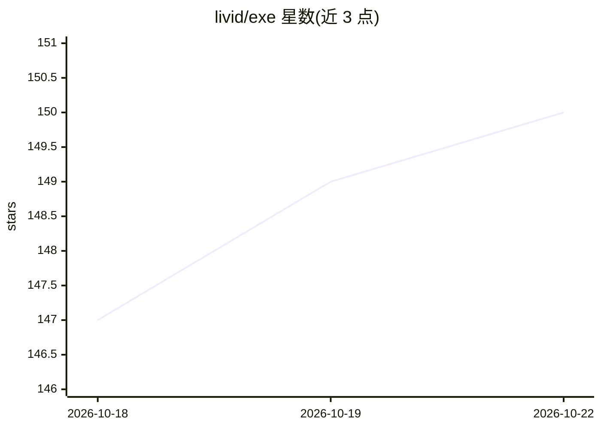

# livid/exe

⭐ 150 · Go · 推送 2026-10-15 · [GitHub](https://github.com/livid/exe) · 个人维护

**单 Go 二进制的个人 VM 云：Linux 虚拟机、AI agent 与隧道发布**

以单一 Go 二进制形式提供个人虚拟机云：在 macOS（Virtualization.framework）、Linux（KVM/Firecracker）、Windows（QEMU/WHP）上创建持久化 Linux VM，VM 内可运行 AI coding agent，可读取配置中指定的 Ollama 模型；任意 VM 端口可经 Cloudflare Tunnel 发布为 HTTPS 子域名。Web UI 为浏览器中的 Mac OS 9 Platinum 桌面，也可经 SSH 或由 agent 驱动。通过一行脚本安装二进制，或以 Go 1.25+ 从源码构建；首次 create 需下载约 3GB 的 Debian 13 镜像。

## 筛选速览

| 维度 | 判定 | 备注 |
|---|---|---|
| AI 角色 | `ai-ecosystem` | LLM/agent 周边工具 |
| 许可风险 | `none` | — |
| 部署形态 | `desktop` | 安装包/桌面程序 |
| 模型依赖 | local-ok | 支持本地模型 |
| 硬件要求 | — | 无带数字的原话,不猜 |
| 安装摩擦 | `low` | 无编译、无系统依赖或容器化 |
| 成熟度 | — | 结构信号不足 |

## 能力要点

- 跨三平台创建持久化 Linux VM（macOS/Linux/Windows 各用不同虚拟化后端）
- exe code 让 AI coding agent 在 VM 内执行任务，对接配置中的 Ollama
- 任意 VM 端口经 Cloudflare Tunnel 发布为 HTTPS 子域名
- Web UI 为 Mac OS 9 风格桌面，含 Codex、Claude Code、btop 等应用

## 适用场景

- 在自己电脑上开一台即用即弃的 Linux VM 写代码
- 让 AI coding agent 在隔离 VM 内执行开发任务
- 把 VM 里跑的服务经隧道暴露为公网 HTTPS 地址

## 场景标签

 · 领域:虚拟化/个人云

## 证据(README 行号)

> L4: macOS, Linux or Windows, vibecode inside them with models from Ollama Cloud, and publish
> L55: `exe code` talks to the Ollama named in the configuration.
> L60: ./exe code demo "build me a guestbook app on port 8000"

## 星数曲线

2026-10-18 147 → 2026-10-22 150（+3）

---
*卡片 v1 · prompt 1.4 · 生成 2026-10-22 · 置信度 high · 依据 README sha `5c69d5be27db` · [字段定义](../../DATASET.md)*
