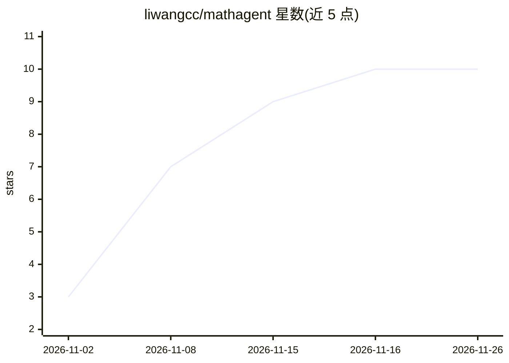

# liwangcc/mathagent

⭐ 10 · Python · AGPL-3.0 · 推送 2026-11-25 · [GitHub](https://github.com/liwangcc/mathagent) · [官网](https://www.mathagent.com.cn) · 个人维护 · 中文 README

**高中数学教师的私有部署 AI 批阅工作台**

面向数学教师的私有部署批阅系统：导入试卷后经模板确认、学生卷 OCR、数学判分、教师复核、统计与报告导出完成整个批阅流程。关键机制是模板差分——学生卷与教师冻结模板做 OpenCV 对齐后相减，只留笔迹送 OCR，避免模型借印刷题干「改对」学生错答；并采用按题分片与跨页尾块保持续题上下文。后端 FastAPI + SQLite 单实例部署，支持 Docker 与手动 systemd 部署，模型密钥 AES-GCM 加密存储，判分只收转录文本。

## 筛选速览

| 维度 | 判定 | 备注 |
|---|---|---|
| AI 角色 | `ai-native` | 本体是模型或模型工具 |
| 许可风险 | `viral` | AGPL-3.0 |
| 部署形态 | `desktop` | 安装包/桌面程序 |
| 模型依赖 | — | README 未给出锁定关系 |
| 硬件要求 | — | 无带数字的原话,不猜 |
| 安装摩擦 | `low` | 无编译、无系统依赖或容器化 |
| 成熟度 | — | 结构信号不足 |

## 能力要点

- 模板差分管线：印刷题干在输入阶段移除，转录只看差分图
- 三道闸架构：差分图输入 / 抹残留虚线 / 判分只收文本
- 按题分片与跨页尾块：续题题干上下文不新增调用
- evidence/ 目录提供可复算的原始回执数据

## 适用场景

- 教师批改高中数学课后作业并复核评分
- 整理错题数据、生成班级成绩报告
- 学校内网私有部署批阅系统以保护学生数据

## 场景标签

`OCR` · 领域:感知与多模态

## 证据(README 行号)

> L3: 面向数学教师的私有部署智能批阅工作台：导入试卷或答题卡，完成模板确认、学生 OCR、数学判分、教师复核、统计和报告导出。
> L79: 4. **转录只看差分图，判分只收文本**。

## 星数曲线

2026-11-02 3 → 2026-11-26 10（+7）

---
*卡片 v1 · prompt 1.4 · 生成 2026-11-19 · 置信度 high · 依据 README sha `a91aa0c3d6e9` · [字段定义](../../DATASET.md)*
