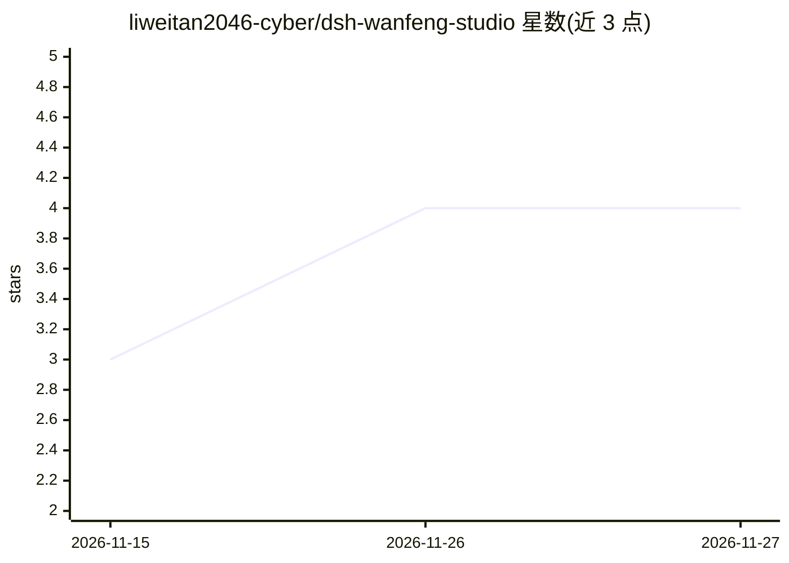

# liweitan2046-cyber/dsh-wanfeng-studio

⭐ 4 · JavaScript · MIT · 推送 2026-11-12 · [GitHub](https://github.com/liweitan2046-cyber/dsh-wanfeng-studio) · 个人维护 · 中文 README

**短视频复刻五步流水线插件：换人、质检到成片**

装在 DeepSeek Harness 中的插件，将「选原片→出角色图→换人→质检→成片」五步放在一个 Web 界面内：原片按镜头切分，图形模型重画主角（带服务端审核门，未通过则换人接口返回 403），每镜头调用 RunningHub 换人工作流，视觉模型抽帧判定身份/变形/文字等问题，最后拼接成片并可选超分。支持接入任意可 API 调用的 RunningHub 工作流，自带素材库与三轨时间线。用户需自备 RunningHub 与 APIMart 的 API Key 并付费。

## 筛选速览

| 维度 | 判定 | 备注 |
|---|---|---|
| AI 角色 | `ai-native` | 本体是模型或模型工具 |
| 许可风险 | `permissive` | MIT |
| 部署形态 | `library` | 以包/库形式分发 |
| 模型依赖 | — | README 未给出锁定关系 |
| 硬件要求 | — | 无带数字的原话,不猜 |
| 安装摩擦 | `medium` | 含编译或系统依赖之一 |
| 成熟度 | — | 结构信号不足 |

## 能力要点

- 五步流水线：切镜→角色图→换人→质检→成片
- 服务端审核门：角色图未通过时换人接口返回 403
- 工作流实验室：探测 RunningHub 工作流节点并自动映射输入
- 质检抽帧判定身份/第二张脸/变形/烧录文字/跳变

## 适用场景

- 按镜头复刻一条爆款短视频并替换主角
- 接入自己的 RunningHub 工作流做视频处理
- 管理视频素材、时间线草稿与脚本任务

## 场景标签

`图像生成` `图像视频处理` · 领域:内容生成

## 证据(README 行号)

> L8: 一个装在 DeepSeek Harness 里的**爆款短视频复刻工作台**。
> L25: |② 角色图|用图形模型按「服装 / 姿势 / 场景」重画主角，**必须人工审核通过**|是（APIMart 图片）|
> L26: |③ 换人|每个镜头跑一次换人工作流，人物替换、机位与背景保持原片像素|是（RunningHub）|

## 星数曲线

2026-11-15 3 → 2026-11-27 4（+1）

---
*卡片 v1 · prompt 1.4 · 生成 2026-11-26 · 置信度 high · 依据 README sha `f131483363ad` · [字段定义](../../DATASET.md)*
